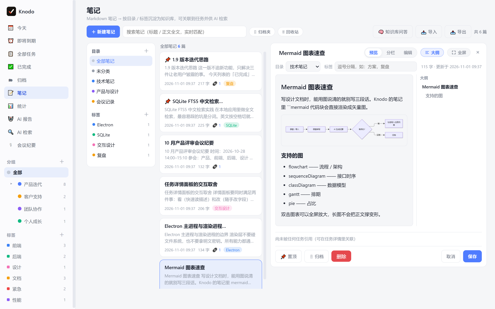
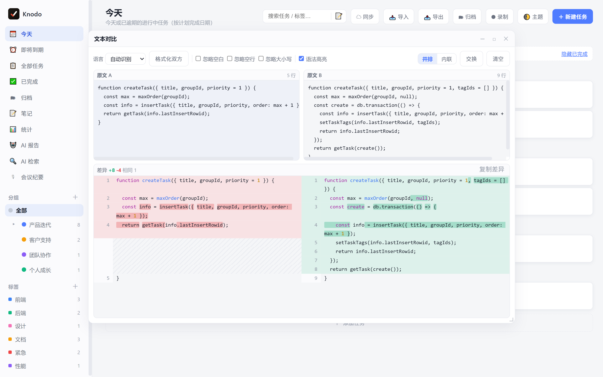
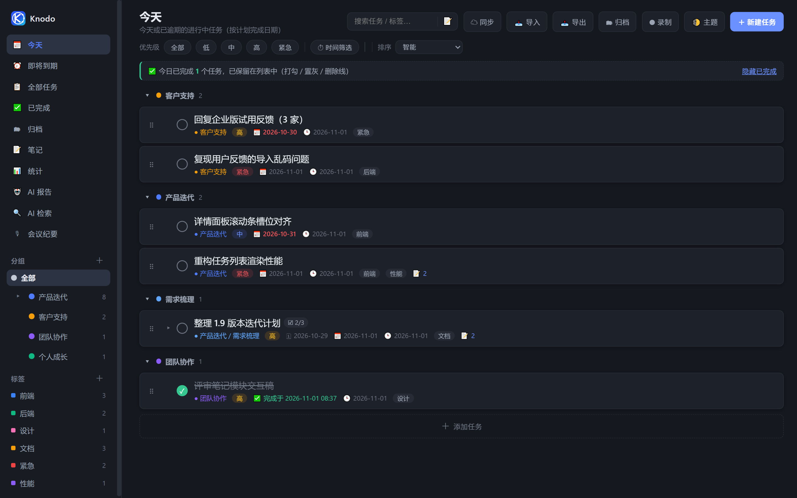

<div align="center">


# Knodo

**Knowledge + Todo** —— 把「待办清单」和「知识沉淀」放进同一个应用。

任务、笔记、会议纪要共用一个本地数据库，AI 报告与检索都建立在你自己的记录之上。<br/>
不注册、不联网同步、不上传，数据始终是本地一个 SQLite 文件。


[为什么是 Knodo](#为什么是-knodo) · [功能亮点](#功能亮点) · [日历](#日历回答这周排得下吗) · [番茄钟](#番茄钟每一格留下一句话) · [快捷键](#快捷键不用切回主窗口) · [快速开始](#快速开始) · [文档](docs/README.md)

<a href="https://gitee.com/kiverson/todo-task/releases/latest"><b>⬇ 下载最新版 · 免安装包（约 90 MB）</b></a>

<sub>Windows 10/11 · 不用注册 · 双击即用 · 不会装？看<a href="docs/下载与安装.md">三步图解</a></sub>

</div>


---

## 为什么是 Knodo

**做完的事不会凭空消失。** 大多数待办应用勾完就把任务藏起来，让你怀疑自己点错了。
Knodo 把它留在原地：打勾、置灰、加删除线，底部告诉你「今天完成了 3 件」，跨天自动归档。

**任务和知识长在一起。** 一条任务可以关联多篇笔记，一篇笔记能看到被哪些任务引用；
任务描述、会议纪要、笔记共用同一套 Markdown 渲染，写下来的东西可以被检索、被 AI 引用，而不是躺在文件夹里。

**AI 是加法，不是前提。** 没配置 API Key 也能用全部功能：报告降级成本地模板，
检索降级成本地分层召回，笔记照常全文搜索。配了 Key 才多出总结、语义重排与问答。

**数据是你的。** 本地 SQLite，无账号体系；数据库就是一个 `.db` 文件，备份是一个 `.zip`（含附件与录音），随时能带走。每天自动留一份数据库快照，主库坏了能一键恢复。

---

## 功能亮点

### 任务：按「今天」工作，其余交给分组

多级分组（父组 ⇄ 子组无限层）、子任务进度、优先级、计划时间范围、标签、提醒。
分组可以直接拖：拖到某行的上 / 下缘 = 插到它前面 / 后面，拖到行中间 = 成为它的子分组，
拖到侧栏空白或「全部」= 回到顶层；右键还有「上移 / 下移 / 移到最前 / 最后 / 移动到分组…」。
「今天」列表里做完的任务会保留，切标签页、重启应用都还在。

### 日历：回答「这周排得下吗」

清单回答「有什么要做」，日历回答「今天还塞得进去吗」。同一份计划日期、两个尺度：列表按分组平铺，
日历按天铺开，并在格子上画一条**负载条** —— 一屏扫过去看到的是「周三爆了、周五空着」，而不是又一份清单。


**负载怎么算**：容量默认 6（4–10 可调），权重按优先级取 低 `0.5` / 中 `1` / 高 `2` / 紧急 `3`，
跨天任务按天数均摊（11/02–11/06 的紧急任务是每天 `0.6`）。所以「6」不是六个任务，而是「这天扛得住的量」。
不做时间轴 —— 计划日期只有年月日，画到小时就是编；也不要求填预估工时 —— 填的人少，填了也未必准。

**排期就是拖**：

- 左栏「待安排」是还没排期的任务，拖到某个格子即排期；跨天任务从落点那天起连着占几天。
- 拖动过程中格子上实时显示「放下后 4.2 / 6」并预画负载条 —— **松手之前就知道后果**。
- 放到已经排满的一天，会弹「这一天会超载」，给两个选择：仍然放入，或**放到下一个空日**（往后找放进去仍不超过容量 60% 的第一天）。
- 拖回左栏 = 取消排期；拖到网格左右边缘停 0.8 秒自动翻月，跨月排期不用来回切两次。
- 每次改期都有 5 秒撤销条；右键卡片另有「延期一天 / 移出排期」。

**看与改都不离开这一页**：

- 点某天 → 右栏出当日面板：当日负载、按分组列出的任务清单（直接勾选、改优先级、打开详情），不跳页、不滚动。
- 格子里最多放 2 条，更多的收成「+N」，点开就是右栏那天的完整清单。
- 超载格是浅红底 + 红框 + 溢出角标（超过容量 140% 再加斜纹，不只靠颜色，色弱也能认出）；今天格是蓝底描边；跨天任务在续日显示「↳ 标题」，不丢信息。
- 超期的欠账只在「今天」格里汇总成一颗红徽标 + 一行「⚠ 积压 N 条（最早 11-01）」，点开可逐条「改到今天」或一键全改。

月 / 周切换在日历右上角，「回到今天」一键回位。周视图是 7 列竖排、任务标题完整展开，专门用来看细节：


**容量与口径**：在「调整每日容量」或 设置 → 日历 里改容量（4–10）、周起始日（周一 / 周日）、
是否显示已完成任务（降为 40% 透明度且不计负载）。容量只是提醒，不会拦住你往爆满的日子塞东西 ——
工具替你做判断，但不替你决定哪天加班。底部还有一条整月负载趋势与「本月 N 天有安排 · M 天超载 · 平均负载 X%」，
用来回答另一个问题：是不是整个月都排太满了。

入口在侧栏「🗓 日历」，或按 `Ctrl+Alt+M`（再按一次回到原来的列表）。日历没有新增字段也没有新表 ——
它读的就是「今天 / 即将到期」用的那份 `plan_start / plan_end`，所以备份、导入导出、AI 报告的口径全都自动一致。

### 详情：改一个字，不用开两个页面

点任务行展开右侧抽屉：描述所见即所得编辑、图片直接插入光标处、附件与关联笔记都在手边。
所有字段停止输入约 0.7 秒自动保存，保存失败保留输入并可重试 —— 没有「保存」按钮要按。


### 笔记：写得进去，也找得回来

Markdown 编辑器（编辑 / 分栏 / 预览）、代码块高亮、Mermaid 图表、截图直接粘贴、
无限层级目录与标签、FTS5 中文全文检索、回收站。写下的内容会自动切块进知识库，
可以就着自己的笔记提问并跳回出处。顶栏「📝 笔记」不离开当前清单就能写：开一个可拖动、可最大化的笔记窗，
写的是同一份数据。

Mermaid 图块右上角鼠标移上去会露出 **⤢ 放大** 与 **⬇ 下载** 两个按钮：下载走系统「另存为」，导出 2 倍分辨率 PNG，
图里的配色与背景按当前主题铺底，贴进文档、群里、PPT 都不糊（不用为了截图把窗口拉大）。

导出不必先学格式：单篇导出就是一个 `.md`，正文里的图片按 base64 内嵌进去，发给别人不缺图；
多篇导出才打包（每篇一个 `.md`，按目录层级摆放）。



### 会议：录完就有纪要和待办

一键录制（麦克风 + 系统声，Windows 走 WASAPI 回环，无需虚拟声卡），按 5/10/15/30 分钟自动切片，
顺序上传转写，AI 输出「议题 / 决议 / 待办 / 风险」结构化纪要，勾选行动项即可批量写进任务列表。


### AI 报告：周报不用再回忆这周干了什么

日报 / 周报 / 月报基于本地完成记录生成，按 Word 文档版式呈现、可直接编辑、自动保存，
支持追加自定义要求（「按计划完成时间排下个月的工作计划」），导出 Word 或 Markdown，历史记录可回看。

分组筛选支持级联：选中父分组就自动包含它的全部子孙分组，被覆盖的子分组会置灰并标「随父分组」；
历史记录里存的是完整路径（`产品发布 / 1.12 版本`）——父子同名（`项目管理 / 问题项` 与
`数据管理 / 问题项`）时也不会被合并成一条。


### AI 检索：模糊记得也能找到

关键词没精确命中时不直接说「没找到」，而是分层召回：精确 → 字面 → 联想（同义词 / 缩写 / 近似拼写 /
状态与时间语义）→ 语义重排，并明确告诉你「由哪个关键词经哪条联想命中」。


### 统计：数字可以点进去

总任务 / 进行中 / 已完成 / 逾期 / 归档，点卡片直接下钻到任务明细；口径可在「仅主任务 / 含子任务」间切换，
趋势看近 7 天到近一年。


### 桌面浮窗：把清单钉在桌面上

右键任意分组（或「今天」「即将到期」）→「📌 钉到桌面」，桌面上就多一个 286px 的小窗：置顶、不进任务栏、
不抢焦点；高度跟着内容走（不出现半截空白），宽度可拖 240~460px，可折叠成一条标题栏。
位置与尺寸自动记住，靠近屏幕边缘或其它浮窗时会自动对齐吸附，多显示器同样适用，重启后原样回来。


它只是同一份清单（或「今天」「即将到期」这两个视图）的另一个投影：浮窗里勾选立刻写回主库，
主窗口的改动也立刻反映过来；一个窗只放一份清单 / 一个视图，最多 6 个。
「即将到期」窗里每行右侧直接标出到期日（今天 / 明天 / 3 天后 / 11-12），不用再回主窗口确认。想改分组、改计划日期这类结构性操作请回主窗口 ——
巴掌大的窗口里改结构只会改出乱子，所以浮窗内只留了勾选、快速新增、跳回主窗口、删除四件事。

关掉浮窗只是取消投射，任务一条都不会少；源分组被删时浮窗会提示「清单已删除」并在 3 秒后自动收起。
演示或共享屏幕前按 `Ctrl+Alt+D` 一键全部收起，`Ctrl+Alt+1~6` 把第 n 个浮窗顶到最上层 2 秒便于定位。
入口另有两处兜底：菜单栏「实用工具 → 桌面浮窗」与托盘右键。

**置顶方式三档**，在窗内「⋯」里切换：始终置顶（默认）/ 仅悬停置顶 / **贴桌面**。
贴桌面是把浮窗挂进桌面层，不是「不置顶」——桌面图标本来就能被窗口盖住，所以按 `Win+D` 看桌面时它还在，
而任何应用窗口都能盖住它。点它、拖它、右键它都正常；桌面层被系统重建（重启资源管理器、切显示桌面）
会把浮窗一起带走，程序会自动把它挂回来，不会是「浮窗自己消失了」。
这一档依赖 Windows 原生调用，环境不支持时菜单会直接写「当前系统不支持」并置灰，不会出现「选了没反应」。
另外它为了保住圆角会把窗口裁成圆角区域，所以四角边缘没有抗锯齿（换来的是浅色模式下不再有黑尖角）。

### 番茄钟：每一格留下一句话

番茄钟最容易死在「攒了 8 个番茄，回头看不知道干了什么」。所以这里的产物不是时长，是一句话。

悬停任意任务行，右侧出现 **▶**：点一下开始专注。默认 30 分钟，点旁边的 `30'` 可在 15 / 30 / 45 分钟之间切换（记住上次的选择）。
专注期间这一行左侧走进度环、右侧走剩余时间，`Ctrl+Enter` 暂停 / 继续（也可以直接点进度环）；
切到 IDE、浏览器继续干活**不会停表** —— 只有「所有 Knodo 窗口都不在前台，且系统连续 3 分钟没有键鼠输入」才算真离开。

跑满一格，任务行下方就地展开收尾条，光标已经在输入框里：「做到哪了？」


写完回车即存 —— 这句话带时间戳写进任务备注，并出现在详情右侧的「专注 🍅」时间线里（`●` 整格 / `◐` 半格，附实际时长）。
不想写就按 `Esc` 或「跳过」，不留痕、不弹二次确认；点「再来一格」直接续上下一次。


**三种结局，没有「作废」**：跑满记 1 格；中途主动结束或被打断、已经投入 8 分钟以上记 0.5 格并写明原因
（暂停超过 3 分钟 / 离开超过 3 分钟 / 休眠中断）；不足 8 分钟就当没发生过，不留脏数据。
惩罚中断的番茄钟最后都会被整个关掉，所以这里不惩罚。

格数显示在任务标题右侧（最多 3 个点 + 「+N」）与顶栏「今天 N 格」；顶栏不显示目标值，不制造「今天还差 6 格」的压力。
连续 3 格（90 分钟）收尾条会软提示「起来走两步」，4 格以上建议换个任务 —— 只提示，不强制休息。
番茄必须挂在任务上，没有「自由专注」：不挂任务的计时，最后只会剩一个数字。


钉在桌面上的浮窗里，正在专注的那一行同样显示进度环与倒计时（只读，不给入口 —— 开钟 / 收尾都在主窗口完成）。
番茄记录存在本地 `focus_sessions` 表，随完整备份一起走；删掉任务时记录会保留（一小时的真实投入不该因为删任务蒸发），展示降级为「已删除的任务」。

### 快捷键：不用切回主窗口

全局键在应用不在前台时也生效，默认 13 个：

| 按键 | 作用 |
|---|---|
| `Ctrl+Alt+B` | 唤起 / 收起主窗口 |
| `Ctrl+Shift+H` | 唤起主窗口并打开笔记（再按一次收起） |
| `Ctrl+Alt+N` | 快速添加任务 |
| `Ctrl+Alt+C` | 快速捕捉（在当前屏幕顶部弹一条输入条） |
| `Ctrl+Alt+D` | 显示 / 隐藏全部桌面浮窗 |
| `Ctrl+Alt+1~6` | 把第 n 个桌面浮窗置顶 2 秒 |
| `Ctrl+Alt+M` | 日历视图 |
| `Ctrl+Alt+E` | 上班鼓励器（趣味功能主浮窗） |

`Ctrl+Shift+H` 打开的是笔记**弹窗**而不是切页：任务列表还在原地，面板里就是完整笔记界面。
收起时只收窗口、不关面板 —— 里面可能正开着某篇笔记，关掉等于清空上下文，下次唤起还是那篇。

**快速捕捉**解决的是第三种意图：不打算切换上下文，只把一闪念存下来。按 `Ctrl+Alt+C`，
鼠标所在屏幕顶部浮出一条 520px 的输入条 —— 回车即存，存完**不关闭**，可以连着记几条；
`Tab` 换落点清单，`Esc` 收起，没提交的内容留在内存里，下次按 C 还在。
中文输入法按回车只是上屏，不会被当成提交（不会出现"打三个字存三条脏数据"）。


主窗口内另有一套固定键：`↑ ↓` 选中任务、`Space` 勾选、`Enter` 打开详情、
`Delete` 删除（5 秒内 `Ctrl+Z` 可撤销）、`Ctrl+N` 新建任务、`Ctrl+Shift+N` 新建笔记、
`Ctrl+Enter` 暂停 / 继续专注、`Ctrl+F` 搜索、`Ctrl+,` 打开设置。

全局键都能在 **设置 → 快捷键** 里录制修改：点右侧键位胶囊，按下新组合即可。
新键被别的程序占用时会当场说明并**保留原键**（不会出现「键换了、功能却没了」），
同一个组合也不会同时绑到两个动作上 —— 真要撞了，先注册的那个保留生效，另一个在列表里标出来，不再互相抢。
桌面浮窗的显隐键这次从 `Ctrl+Alt+H` 改成了 `Ctrl+Alt+D`：它和笔记键 `Ctrl+Shift+H` 只差一个修饰键，实机上太容易按混。
设置中心本身也重做了：左侧分组导航（通用 / 快捷键 / AI 与语音 / 日历 / 趣味功能 / 数据与备份 / 关于）+ 顶部搜索，改完立刻生效，没有「保存」按钮。


### 顺手能用的小工具

文本对比、JSON 查看器 —— 都是非模态浮窗，开着也不挡主界面。
笔记视图工具栏的「📤 导出」可按目录 / 标签批量导出成自包含的 `.md`（图片内嵌），单篇笔记也能直接导出。



### 上班鼓励器 · 工位搭子

顶格【趣味功能】菜单或 `Ctrl+Alt+E` 打开主浮窗：把工时拆成每秒进账、每天一支确定性签、
一只会按语气回话的几何小牛马、只换皮肤不换钱的牛马币，以及可导出的 1080×1440「今日牛马卡」。
浮窗放大到 640×720（随视口收敛），五个页签改成两栏 / 两列排布，一屏就能看全，不用上下滚。

**第一次打开先填薪资**：没填月薪时浮窗顶部会有一张引导卡，点「去填薪资 →」直接切到浮窗内的
「设置」页签；之后随时点右上角 ⚙ 也能回到这里。月薪 / 上班时间 / 下班时间三项边改边保存，
上方「今日已赚」立刻开始每秒跳动，不用点保存、也不用先去别处找设置。
完整路径是「设置 → 趣味功能 → 薪资与班次」，两处改的是同一份配置（`tool.salary`）。

**一份配置、一处计算**：数值统一由 `salary-core.js` 的 `computeSalary()` 算出，不在多处各算一笔钱。
「实时薪资（经典视图）」弹窗与 `Ctrl+Alt+L` 已撤掉，鼓励器是唯一的薪资进账界面。

**隐私默认**：分享卡默认不含真实金额、不含任务标题，想晒具体成果要主动勾选并二次确认。
所有数据只留在本机，没有账号、没有服务端、不联网生成文案。
主浮窗与分享卡都跟随应用明暗主题；鼓励器不再提供贴桌面小窗（侧栏清单 / 今天 / 即将到期的桌面浮窗不受影响）。

### 界面：浅色 / 深色，托盘常驻

<div align="center">

</div>

关闭窗口默认最小化到托盘；可设开机自启（安装版）、可把数据目录换到任意磁盘。

**升级怎么知道有新版本**：`File → 检查更新…`（或 设置 → 关于 → 检查更新）会去查本仓库的最新 Release；
启动约 8 秒后也会静默查一次，有新版只把菜单项标成「检查更新…（发现新版本）」并弹一条提示，
不弹窗打断你正在做的事。它只给下载链接、不自动安装 —— 便携版和安装版的替换方式本来就不一样。

---

## 快速开始

### 直接使用（不需要懂代码）

打开 **[最新版本](https://gitee.com/kiverson/todo-task/releases/latest)**，滑到页面最底部，
点名字带 **便携版** 的那个 `.exe`，下载完双击即可 —— 没有安装向导。

| 文件 | 说明 |
|---|---|
| `Knodo-<版本>-便携版.exe` | **推荐**。单文件绿色版，数据在 exe 同级的 `data/`，整个文件夹拷走即可换机 |
| `Knodo-<版本>-win64.7z` | 解压即用版，需先解压，数据在 `%APPDATA%\todo-desktop`，可开开机自启 |

> ⚠️ 别点 `Source code (zip)` 或页面右上角绿色的「克隆/下载」——那是源代码，下下来用不了。

首次运行若被 Windows 拦下：点「更多信息 → 仍要运行」。
完整的图文步骤、被 360/电脑管家拦截的处理、数据在哪、怎么升级，
见 **[下载与安装](docs/下载与安装.md)**。

### 从源码运行

```bash
npm install     # 首次会下载 Electron 二进制
npm start
```

要求 **Node.js ≥ 18**、**Windows 10/11**。`better-sqlite3` 使用 N-API 预编译二进制，
不需要 Visual Studio 构建工具，也不需要 electron-rebuild。

> 在自带 `ELECTRON_RUN_AS_NODE=1` 的终端里启动会「一闪而过」，
> 用 `env -u ELECTRON_RUN_AS_NODE npm start`。详见[开发指南](docs/开发指南.md)。

---

## 技术栈

| 层 | 选型 |
|---|---|
| 运行环境 | Electron 44（主进程 + preload 收口，渲染层不碰文件系统与明文密钥） |
| 存储 | SQLite（`better-sqlite3`）+ FTS5 trigram 全文索引，WAL 模式 |
| 前端 | 原生 JS + CSS 变量主题，无框架；第三方库 vendor 进仓库、离线可用 |
| AI | OpenAI 兼容 `/chat/completions` 与 `/audio/transcriptions`，可换 DeepSeek / 通义 / Kimi / Ollama |
| 打包 | electron-builder（NSIS 安装版 + 便携版），发布走 Gitee 发行版 |

---

## 文档

| 文档 | 你会在这里找到 |
|---|---|
| [下载与安装](docs/下载与安装.md) | 点哪个文件、被 Windows 拦截怎么办、数据在哪、升级与卸载 |
| [功能详解 · 任务与视图](docs/功能详解-任务与视图.md) | 分组、子任务、日期范围、筛选排序、详情抽屉、统计下钻、日历排期 |
| [功能详解 · 笔记与知识库](docs/功能详解-笔记与知识库.md) | 编辑器、Mermaid、图片、导入导出、检索、知识库问答 |
| [功能详解 · 会议纪要](docs/功能详解-会议纪要.md) | 录制、切片、转写、AI 纪要、待办入库 |
| [功能详解 · AI 能力](docs/功能详解-AI能力.md) | AI 设置、报告、检索联想逻辑、接口配置表 |
| [功能详解 · 效率工具与数据](docs/功能详解-效率工具.md) | 浮窗工具、笔记导出、完整备份与自动快照、托盘与自启 |
| [常见问题](docs/常见问题.md) | 数据在哪、关闭没退出、无 Key 的表现、便携版限制 |
| [开发指南](docs/开发指南.md) | 目录结构、依赖策略、冒烟测试、调试 |
| [数据库设计](docs/数据库设计.md) | 表结构、迁移、FTS、附件协议、备份格式 |
| [打包与发布](docs/打包与发布.md) | 品牌标识、打包产物、7z 瘦身与 Gitee 发版 |

完整索引见 [docs/README.md](docs/README.md)。

---

## 许可

MIT License。第三方库的许可与来源版本登记在 `package.json` 中。
