<div align="center">

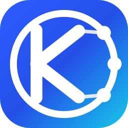

# Knodo

**Knowledge + Todo** —— 把「待办清单」和「知识沉淀」放进同一个应用。

任务、笔记、会议纪要共用一个本地数据库，AI 报告与检索都建立在你自己的记录之上。<br/>
不注册、不联网同步、不上传，数据始终是本地一个 SQLite 文件。


[为什么是 Knodo](#为什么是-knodo) · [功能亮点](#功能亮点) · [重复待办](#重复待办一条任务天天自己出现) · [日历](#日历回答这周排得下吗) · [桌面便签](#桌面便签贴到屏幕顶上收成一行) · [番茄钟](#番茄钟每一格留下一句话) · [外观](#外观六套配色配自己的背景图) · [快捷键](#快捷键不用切回主窗口) · [快速开始](#快速开始) · [文档](docs/README.md)

<a href="https://gitee.com/kiverson/todo-task/releases/latest"><b>⬇ 下载最新版 · 免安装包 / 安装包（约 90 MB）</b></a>

<sub>Windows 10/11 · 不用注册 · 免安装 · 不会装？看<a href="docs/下载与安装.md">三步图解</a></sub>

<sub>下载镜像：<a href="https://github.com/kevin-iverson/knodo/releases/latest">GitHub</a> · <a href="https://gitee.com/kiverson/todo-task/releases/latest">Gitee</a>（两站同版本、同文件，挑打得开的那条）</sub>

</div>

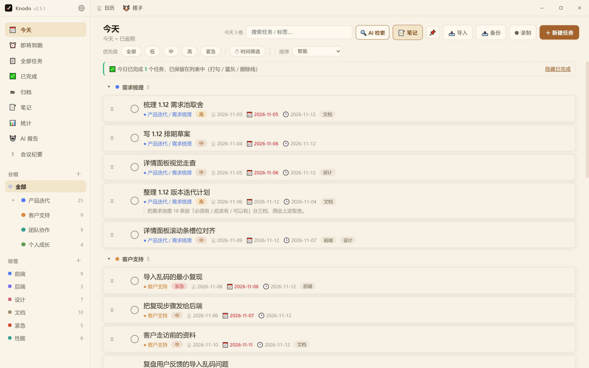

---

## 为什么是 Knodo

**做完的事不会凭空消失。** 大多数待办应用勾完就把任务藏起来，让你怀疑自己点错了。
Knodo 把它留在原地：打勾、置灰、加删除线，底部告诉你「今天完成了 3 件」，跨天自动归档。

**任务和知识长在一起。** 一条任务可以关联多篇笔记，一篇笔记能看到被哪些任务引用；
任务描述和笔记用**同一套所见即所得编辑器**，写下来的东西可以被检索、被 AI 引用，而不是躺在文件夹里。

**AI 是加法，不是前提。** 没配置 API Key 也能用全部功能：报告降级成本地模板，
检索降级成本地分层召回，笔记照常全文搜索。配了 Key 才多出总结、语义重排与问答。

**数据是你的。** 本地 SQLite，无账号体系；数据库就是一个 `.db` 文件，备份是一个 `.zip`（含附件与录音），随时能带走。每天自动留一份数据库快照，主库坏了能一键恢复。

**标识是一笔两色的勾。** 朱砂短臂是「今天要做什么」，象牙长臂是「做完留下什么」，
拐点那颗圆点就是 node —— 两条臂在这里相接，像任务和笔记共用同一个本地数据库：一次完成，就是一个知识节点。
底色是暖墨与纸白，不是蓝底白字的云工具徽章。

---

## 功能亮点

### 任务：按「今天」工作，其余交给分组

多级分组（父组 ⇄ 子组无限层）、子任务进度、优先级、计划时间范围、标签、提醒。
分组可以直接拖：拖到某行的上 / 下缘 = 插到它前面 / 后面，拖到行中间 = 成为它的子分组，
拖到侧栏空白或「全部」= 回到顶层；右键还有「上移 / 下移 / 移到最前 / 最后 / 移动到分组…」。
「今天」列表里做完的任务会保留，切标签页、重启应用都还在。

**列表行直接显示备注摘要**：标题与元信息下面多一行灰色小字（左边一道细竖线），只取纯文本、72 字后省略；
备注里有图片就只留一个 `📷` 角标 —— 不会把 base64 长串画到界面上，也不会把行撑破。
新增任务的行内表单按钮也从「⚙ 更多选项」收成了「⚙ 更多」。

### 重复待办：一条任务，天天自己出现

每天必做的事不该每天手动建一遍，更不该在列表里铺出一堆同名任务。新建或编辑任务时点「🔁 设为重复」，
选一条规则（每天 / 每周几 / 每月几号 / **每个法定工作日**），再定提醒时间与完成日 ——
比如「抽盘仓库」设成每个法定工作日 09:00 提醒，法定连休自动跳过、调休补班的周末自动补上
（内置 2026 / 2027 国务院放假安排，之后年份按周一至周五，全程离线）。

**自始至终只有一条任务。** 它按规则在「今天」等视图里出现、按点提醒，日期与完成态每天自动推进；
照常勾选完成、改优先级、关联笔记、进日历与统计。每次勾选记一次「按日打卡」，跨天后这一条自动恢复未完成，
历史打卡完整保留。把「重复 10 天」改成 8 天、把每周改成每天，都只是改这一条规则，
不会生成或删除任何任务，也不会动已经打过的卡。

设置入口有三个：新建 / 编辑任务时的「🔁 设为重复」、任务详情抽屉的「重复与提醒」区（可就地改规则与提醒时间）、
File → 重复事项与习惯…（管理全部规则、停止 / 恢复、跳过本次）。行内的 🔁 徽标点一下直达该规则。
勾上「作为习惯打卡」，徽标变 💪，面板里能看到应发生次数、累计完成、完成率、连续天数与近 30 次明细，
格子还能点一下补打卡。规则与打卡历史都随备份一起导出导入。

### 日历：回答「这周排得下吗」

清单回答「有什么要做」，日历回答「今天还塞得进去吗」。同一份计划日期、两个尺度：列表按分组平铺，
日历按天铺开，并在格子上画一条**负载条** —— 一屏扫过去看到的是「周三爆了、周五空着」，而不是又一份清单。

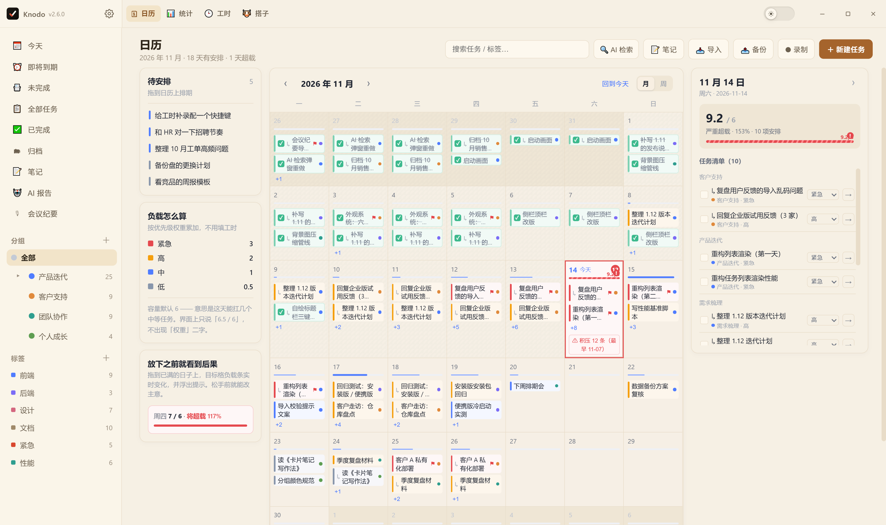

**负载怎么算**：容量默认 6（4–10 可调），权重按优先级取 低 `0.5` / 中 `1` / 高 `2` / 紧急 `3`，
跨天任务按天数均摊（11/02–11/06 的紧急任务是每天 `0.6`）。所以「6」不是六个任务，而是「这天扛得住的量」。
不做时间轴 —— 计划日期只有年月日，画到小时就是编；也不要求填预估工时 —— 填的人少，填了也未必准。

**排期就是拖**：

- 左栏「待安排」是还没排期的任务，拖到某个格子即排期；跨天任务从落点那天起连着占几天。
- 拖动过程中格子上实时显示「放下后 4.2 / 6」并预画负载条 —— **松手之前就知道后果**。
- 放到已经排满的一天，会弹「这一天会超载」，给两个选择：仍然放入，或**放到下一个空日**（往后找放进去仍不超过容量 60% 的第一天）。
- 拖回左栏 = 取消排期；拖到网格左右边缘停 0.8 秒自动翻月，跨月排期不用来回切两次。
- 每次改期都有 5 秒撤销条；右键卡片另有「延期一天 / 移出排期」。

**看与改都不离开这一页**：

- 点某天 → 右栏出当日面板：当日负载、按分组列出的任务清单（直接勾选、改优先级、打开详情），不跳页、不滚动。
- 格子里最多放 2 条，更多的收成「+N」，点开就是右栏那天的完整清单。
- 超载格是浅红底 + 红框 + 溢出角标（超过容量 140% 再加斜纹，不只靠颜色，色弱也能认出）；今天格是蓝底描边；跨天任务在续日显示「↳ 标题」，不丢信息。
- 超期的欠账只在「今天」格里汇总成一颗红徽标 + 一行「⚠ 积压 N 条（最早 11-01）」，点开可逐条「改到今天」或一键全改。

月 / 周切换在日历右上角，「回到今天」一键回位。周视图是 7 列竖排、任务标题完整展开，专门用来看细节：

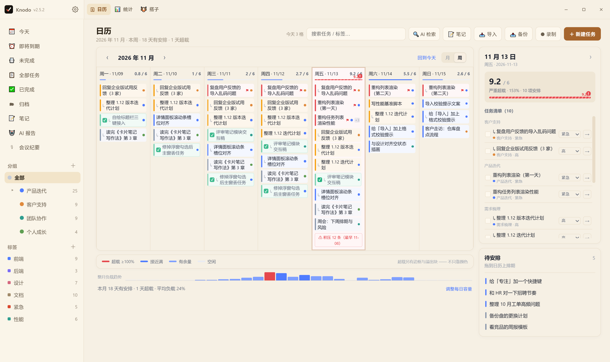

**容量与口径**：在「调整每日容量」或 设置 → 日历 里改容量（4–10）、周起始日（周一 / 周日）、
是否隐藏已完成任务。容量只是提醒，不会拦住你往爆满的日子塞东西 ——
工具替你做判断，但不替你决定哪天加班。底部还有一条整月负载趋势与「本月 N 天有安排 · M 天超载 · 平均负载 X%」，
用来回答另一个问题：是不是整个月都排太满了。

**勾掉的事不会从日历上消失。** 已完成任务默认留在原来的格子里：淡绿底 + 常驻绿勾 + 删除线，
但**不计入负载**；第二天、下周回头看，能直接看到那天到底做完了什么。不想看就在设置里勾「隐藏已完成任务」。

完成态刻意不靠「整块变淡」来表示 —— 把整张卡（连同勾和删除线）一起压到 60% 透明度，在淡色优先级底上会糊成一片，
还不如让人一眼看到「这条已经做完了」。所以只弱化文字色，勾选框保持满不透明，且已完成卡片常驻显示勾
（未完成的卡片仍是悬停才出勾，省标题宽度）。

**勾错了能撤销，但只能撤今天。** 当天的格子照常勾选 / 取消完成，取消后任务按逾期积压移回今天，
所以顶部给 10 秒撤销条（比别处改期的 5 秒长，因为跨天移动更难找回来）。
**过去的日期只读**：昨天的格子不给勾，也不给撤 —— 在日历上改历史，看不出代价却会改掉那天真实发生的事
（一次性任务的归属日、重复事项那天的打卡）。勾选框在这里显示成灰底 + 禁用光标，要改请去任务列表或详情。

重复事项的**历史打卡也会回填到日历**：一个每天的重复任务，过去每一天都留着一格打卡记录，
点开就能看到哪天断了、哪天补上了。这类历史格子同样是只读视图；要调整某一天的打卡，
到「重复事项 → 打卡日历」里改 —— 打卡历史只增不改，日历只是它的一个视图。

入口在侧栏「🗓 日历」，或按 `Ctrl+Alt+M`（再按一次回到原来的列表）。日历没有新增字段也没有新表 ——
它读的就是「今天 / 即将到期」用的那份 `plan_start / plan_end`，所以备份、导入导出、AI 报告的口径全都自动一致。

### 详情：改一个字，不用开两个页面

点任务行展开右侧抽屉：描述就是笔记里那个编辑器 —— 工具条常驻、点一下加粗 / 颜色 / 列表 / 表格 / 图片即生效，
正文里看不到 `**` 和 `#`；从别处粘一段 Markdown 进来会问你要不要转成排版（不转就按原文落进去，
半路关掉浮层也绝不丢内容）。图片直接插到光标处，附件与关联笔记都在手边。
所有字段停止输入约 0.7 秒自动保存，保存失败保留输入并可重试 —— 没有「保存」按钮要按。

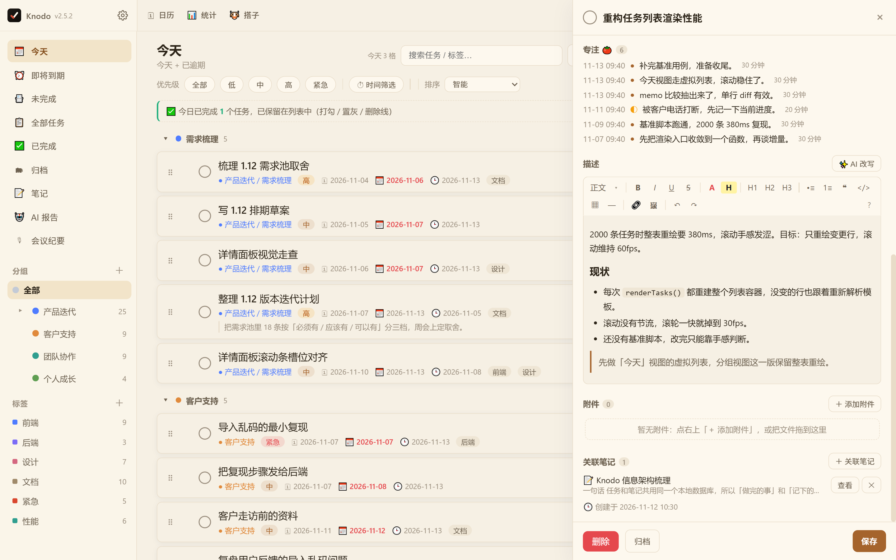

### 笔记：写得进去，也找得回来

**正文里看不到 `**` 和 `#`。** 打开笔记先看到的是只读的成品，点右上角「✎ 编辑」才进入可编辑态，
工具条出现在标题下方并**吸顶** —— 正文再长也不跟着滚走，滚到哪儿都能直接排版。
加粗、斜体、颜色、高亮、列表、引用、表格、图片都是点一下即生效；点「✓ 完成」或按 Esc 立刻保存回只读。
两态共用同一份渲染结果与样式，切换不重渲，内容和光标不会跳一下。

存进去的仍然是 Markdown：保存时只把**真正改过的段落**写回去，没动过的部分字节级不变
（颜色高亮、Mermaid、带语言标签的代码块、表格、图片链接都有专门的还原规则），
所以不会因为「打开 → 改一个字 → 保存」把整篇笔记重排一遍，导出依旧是干净的 `.md`。

代码块点 `</>` 先选语言（24 种，含 Mermaid），插入后左上角带语言标签，编辑态点标签就能换语言、代码原样保留。
Mermaid 图块鼠标移上去会露出 **⤢ 放大** 与 **⬇ 下载**：下载走系统「另存为」，导出 2 倍分辨率 PNG，
配色与背景按当前主题铺底，贴进文档、群里、PPT 都不糊。

无限层级目录与标签、FTS5 中文全文检索、回收站；写下的内容会自动切块进知识库，可以就着自己的笔记提问并跳回出处。
顶栏「📝 笔记」不离开当前清单就能写：开一个可拖动、可最大化的笔记窗，写的是同一份数据。

**笔记也能钉到桌面，而且能就地改。** 笔记详情底栏点「🖥 钉到桌面」，这一篇就变成桌面上 380 宽的小窗
（可拖宽到 460）：读态按 Markdown 正常排版，代码高亮、引用、图片都在；点「✎ 编辑」（或 `Ctrl+E`）进编辑态，
打字 700 毫秒自动落库，`Esc` 或「✓ 完成」立刻保存并退出。小窗排不下工具条，排版用 `Ctrl+B/I/U`、
`Ctrl+Alt+1~3` 这些快捷键。

它是同一篇笔记的另一个投影，用的是同一个编辑器内核：主窗口里改同一篇会广播过来，但你正在输入、
或者还有未保存的改动时，浮窗不会被覆盖；笔记进了回收站，浮窗显示「该笔记已删除」并在 3 秒后自动收起。

导出不必先学格式：单篇导出就是一个 `.md`，正文里的图片按 base64 内嵌进去，发给别人不缺图；
多篇导出才打包（每篇一个 `.md`，按目录层级摆放）。

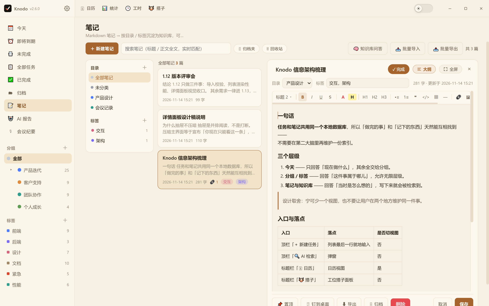

### 会议：录完就有纪要和待办

一键录制（麦克风 + 系统声，Windows 走 WASAPI 回环，无需虚拟声卡），按 5/10/15/30 分钟自动切片，
顺序上传转写，AI 输出「议题 / 决议 / 待办 / 风险」结构化纪要，勾选行动项即可批量写进任务列表。

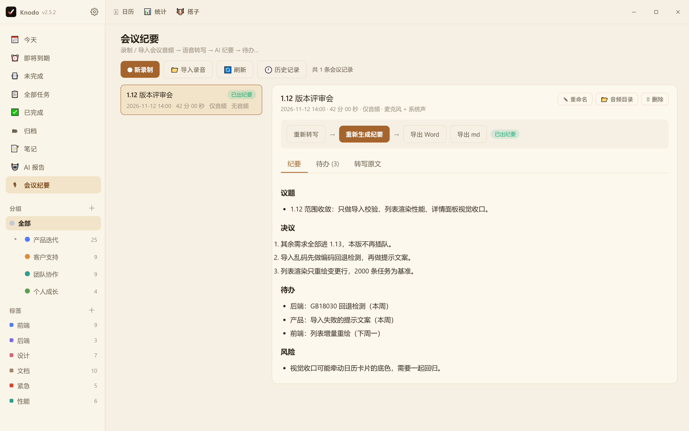

### AI 报告：周报不用再回忆这周干了什么

日报 / 周报 / 月报基于本地完成记录生成，按 Word 文档版式呈现、可直接编辑、自动保存，
支持追加自定义要求（「按计划完成时间排下个月的工作计划」），导出 Word 或 Markdown，历史记录可回看。

分组筛选支持级联：选中父分组就自动包含它的全部子孙分组，被覆盖的子分组会置灰并标「随父分组」；
历史记录里存的是完整路径（`产品发布 / 1.12 版本`）——父子同名（`项目管理 / 问题项` 与
`数据管理 / 问题项`）时也不会被合并成一条。

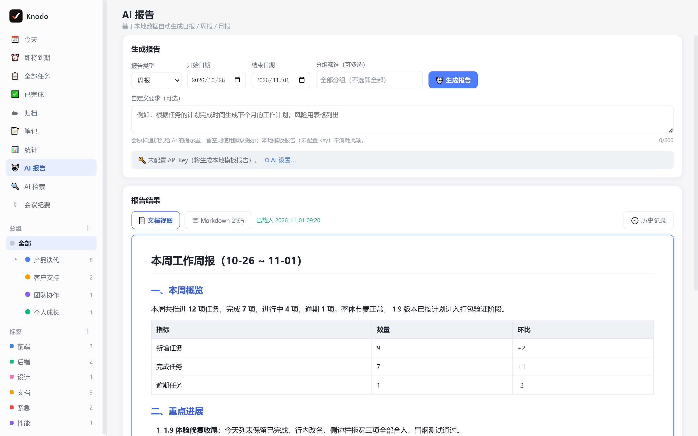

### AI 检索：模糊记得也能找到

关键词没精确命中时不直接说「没找到」，而是分层召回：精确 → 字面 → 联想（同义词 / 缩写 / 近似拼写 /
状态与时间语义）→ 语义重排，并明确告诉你「由哪个关键词经哪条联想命中」。

它是一扇**弹窗**，不是又一个页面：点顶栏「🔍 AI 检索」，顶栏搜索框里的词直接带进来；
弹窗左边是「检索历史」窄栏，右边是结果区 —— 前者回答「上次查的是什么」，后者才是主角，
所以历史固定窄、结果占满剩余宽度。空态给四个示例关键词，点一下就能查，不用先想好怎么描述。
查完关掉弹窗就回到原来的清单：视图、滚动位置、正在做的事一样都不动。

**只有 ✕ 和底部「关闭」能让它退出。** 点遮罩、按 Esc 都不关 —— 检索要花 AI 额度，
误触一下就把结果弄丢，代价比「多按一次 Esc」大得多。点结果也**不关窗**：详情抽屉会临时抬到遮罩之上，
看完一条还能接着看下一条，关掉抽屉结果列表还在原位。再点一次顶栏按钮不会叠第二层，
只会把焦点放回输入框（两层叠着的时候，一次 Esc 会关掉两层）。

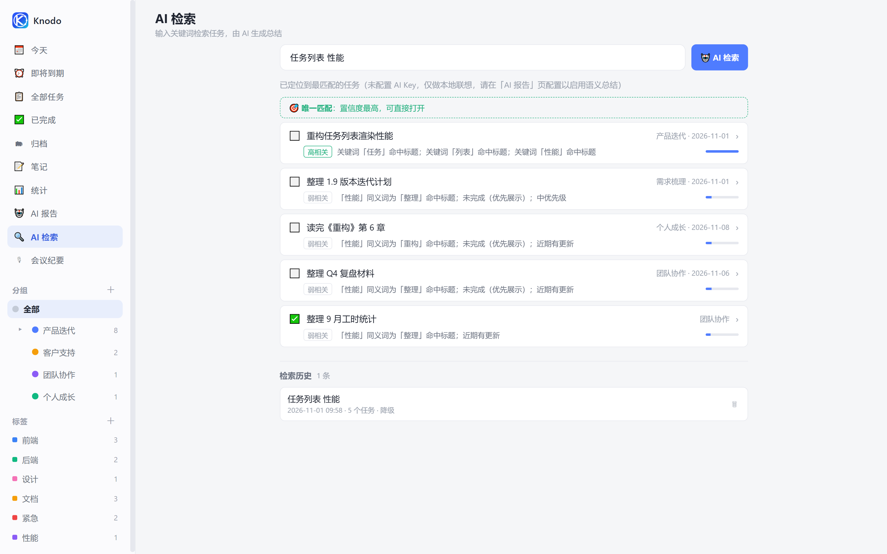

### 统计：数字可以点进去

总任务 / 进行中 / 已完成 / 逾期 / 归档，点卡片直接下钻到任务明细；口径可在「仅主任务 / 含子任务」间切换，
趋势看近 7 天到近一年。

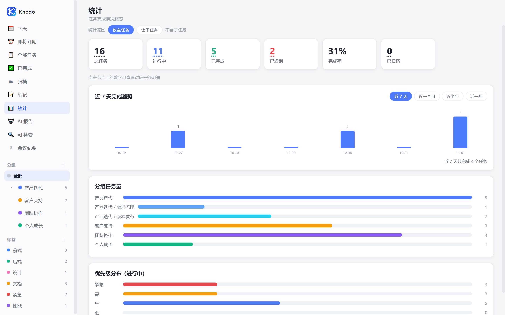

### 桌面浮窗：把清单钉在桌面上

右键任意分组（或「今天」「即将到期」「未完成」）→「📌 钉到桌面」，桌面上就多一个 286px 的小窗：置顶、不进任务栏、
不抢焦点；高度跟着内容走（不出现半截空白），宽度可拖 240~460px，可折叠成一条标题栏。
位置与尺寸自动记住，靠近屏幕边缘或其它浮窗时会自动对齐吸附，多显示器同样适用，重启后原样回来。

**「未完成」是跨分组的全局口径**：逾期 / 今天 / 之后 / 未安排四段分开列，逾期按逾期天数从旧到新排在最上面 ——
不用先去点五个分组才能知道到底还剩多少。段头带未勾数，全做完就是一句「都做完了 · 今天到此为止」。

标题栏也不往标题里塞数字了：左边一颗「逾期 N」红标、右边一颗「未完成 N」品牌色药丸，
一眼分得清「有几条欠着」和「总共还剩多少」。286px 宽是最紧的场景，标题依然不会被截断。

每一行左边有一颗 **8px 优先级色点**（低灰 / 中青 / 高橙 / 紧急红，深色主题另有一套更亮的色值），
行名后面还跟一个同色的文字标签（低 / 中 / 高 / 紧急）—— 色弱认不出颜色也能读。
紧急行额外加一根左竖条与淡红底。色点用固定四色、不跟分组色走：分组点大量是蓝色，撞色会被误读成「这是分组颜色」。
主列表里改优先级，浮窗会立刻跟着变（不是等下次刷新）。

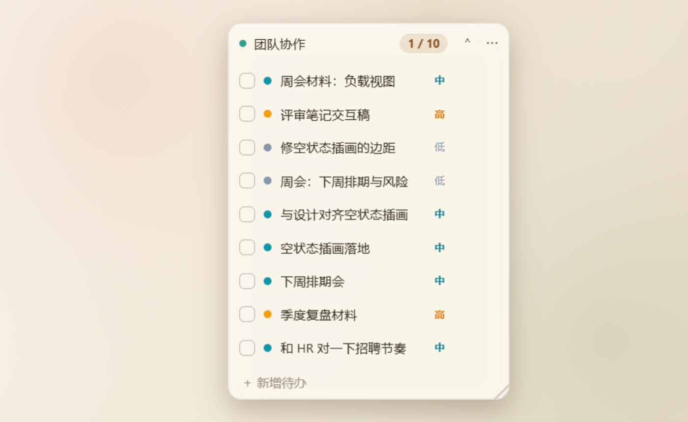

它只是同一份清单（或「今天」「即将到期」「未完成」这几个视图）的另一个投影：浮窗里勾选立刻写回主库，
主窗口的改动也立刻反映过来；一个窗只放一份清单 / 一个视图，最多 6 个。
「即将到期」窗里每行右侧直接标出到期日（今天 / 明天 / 3 天后 / 11-12），不用再回主窗口确认。想改分组、改计划日期这类结构性操作请回主窗口 ——
巴掌大的窗口里改结构只会改出乱子，所以浮窗内只留了勾选、快速新增、跳回主窗口、删除四件事。

关掉浮窗只是取消投射，任务一条都不会少；源分组被删时浮窗会提示「清单已删除」并在 3 秒后自动收起。
演示或共享屏幕前按 `Ctrl+Alt+D` 一键全部收起，`Ctrl+Alt+1~6` 把第 n 个浮窗顶到最上层 2 秒便于定位。
入口另有两处兜底：设置 → 工具 → 桌面浮窗（已钉清单的显示 / 隐藏 / 复位）与托盘右键。

**置顶方式三档**，在窗内「⋯」里切换：始终置顶（默认）/ 仅悬停置顶 / **贴桌面**。
贴桌面是把浮窗挂进桌面层，不是「不置顶」——桌面图标本来就能被窗口盖住，所以按 `Win+D` 看桌面时它还在，
而任何应用窗口都能盖住它。点它、拖它、右键它都正常；桌面层被系统重建（重启资源管理器、切显示桌面）
会把浮窗一起带走，程序会自动把它挂回来，不会是「浮窗自己消失了」。
这一档依赖 Windows 原生调用，环境不支持时菜单会直接写「当前系统不支持」并置灰，不会出现「选了没反应」。
另外它为了保住圆角会把窗口裁成圆角区域，所以四角边缘没有抗锯齿（换来的是浅色模式下不再有黑尖角）。

### 桌面便签：贴到屏幕顶上，收成一行

浮窗还能**贴到屏幕顶部**：点顶栏的 📌，或在浮窗「⋯」里选「贴到屏幕顶部」。它平时只占屏幕最上面一行 30px，
写着「未完成 22 · 逾期 3」—— 不点开也知道今天还剩多少、有几条欠着。

鼠标移到那一行，120ms 后向下展开成 420px 宽的清单（未完成四段：逾期 / 今天 / 之后 / 未安排），
勾选、写新任务都在原地完成；移开 400ms 自动收回。正在输入、拖着滚动条、或者点了「保持展开」时不会收 ——
不会出现「打字打到一半窗口没了」。收得慢一点（400ms）是故意的：展开后窗口变高，鼠标往下移时有一瞬间在窗外。

四个细节值得说明：

- **它始终在最上层**，不是「贴桌面」那一档。贴桌面会被最大化的主窗口盖住，那样便签等于看不见。
  代价是全屏视频 / 游戏时会浮在上面，按 `Esc` 或把它拖走即可。
- **拖着它离开屏幕顶边超过 40px，就自动变回普通浮窗**（位置、尺寸照旧记着）；反过来，
  **把任意浮窗拖到屏幕顶边松手，它会自动贴回去变成便签**，横坐标就落在你松手的地方。
  判定「这是人拖的、而且已经松手」才算数 —— 程序自己把窗口顶到顶边（比如内容变高被夹回工作区）不会被误判成拖动。
- 变回普通浮窗以后，想再贴上去有两条路：浮窗「⋯」菜单里的「贴回屏幕顶边」，或者顶栏 📌 ——
  顶栏那个按钮会优先把已经开着的「未完成」浮窗转成便签，而不是再钉一个同源窗口上去。
- 这一档不跟随自由拖动记忆位置：每次启动都重新按当前屏幕宽度算，换显示器、改分辨率不会跑到屏幕外面去。
  万一真的被拖到所有显示器之外，程序只看「标题栏在任一屏幕还露出 ≥60×12」，全出界才拉回最近那块屏的顶上。

### 番茄钟：每一格留下一句话

番茄钟最容易死在「攒了 8 个番茄，回头看不知道干了什么」。所以这里的产物不是时长，是一句话。

悬停任意任务行，右侧出现 **▶**：点一下开始专注。默认 30 分钟，点旁边的 `30'` 可在 15 / 30 / 45 分钟之间切换（记住上次的选择）。
专注期间这一行左侧走进度环、右侧走剩余时间，`Ctrl+Enter` 暂停 / 继续（也可以直接点进度环）；
切到 IDE、浏览器继续干活**不会停表** —— 只有「所有 Knodo 窗口都不在前台，且系统连续 3 分钟没有键鼠输入」才算真离开。

跑满一格，任务行下方就地展开收尾条，光标已经在输入框里：「做到哪了？」

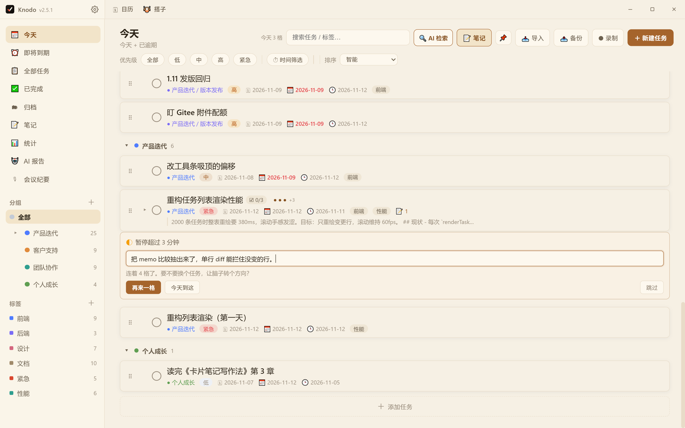

写完回车即存 —— 这句话带时间戳写进任务备注，并出现在详情右侧的「专注 🍅」时间线里（`●` 整格 / `◐` 半格，附实际时长）。
不想写就按 `Esc` 或「跳过」，不留痕、不弹二次确认；点「再来一格」直接续上下一次。

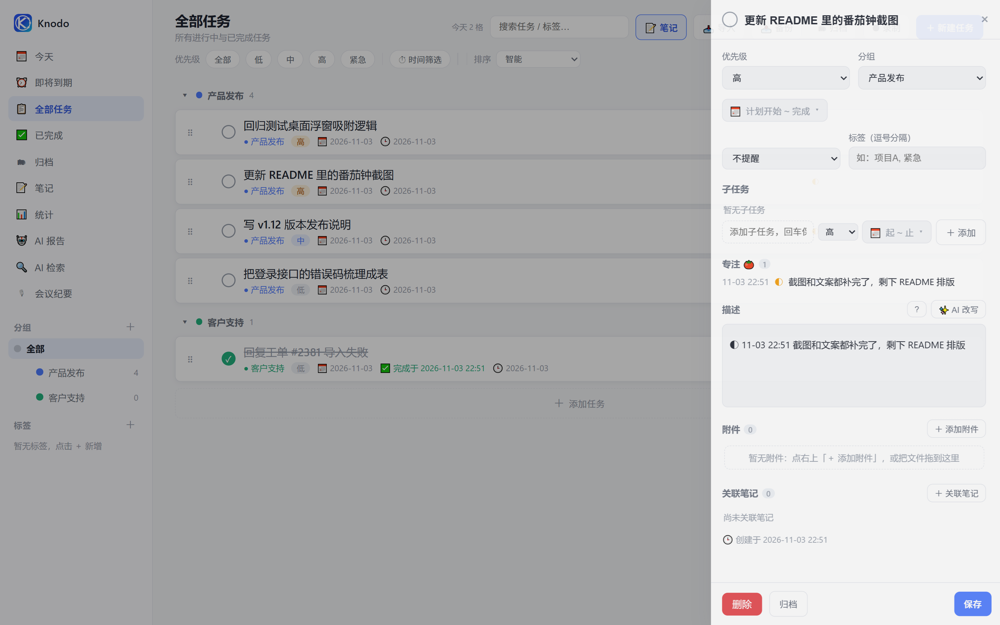

**三种结局，没有「作废」**：跑满记 1 格；中途主动结束或被打断、已经投入 8 分钟以上记 0.5 格并写明原因
（暂停超过 3 分钟 / 离开超过 3 分钟 / 休眠中断）；不足 8 分钟就当没发生过，不留脏数据。
惩罚中断的番茄钟最后都会被整个关掉，所以这里不惩罚。

格数显示在任务标题右侧（最多 3 个点 + 「+N」）与顶栏「今天 N 格」；顶栏不显示目标值，不制造「今天还差 6 格」的压力。
连续 3 格（90 分钟）收尾条会软提示「起来走两步」，4 格以上建议换个任务 —— 只提示，不强制休息。
番茄必须挂在任务上，没有「自由专注」：不挂任务的计时，最后只会剩一个数字。

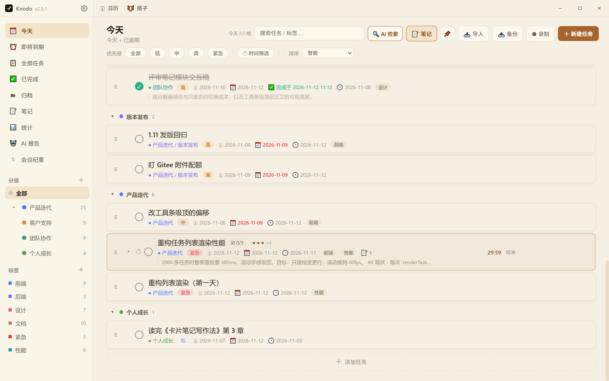

钉在桌面上的浮窗里，正在专注的那一行同样显示进度环与倒计时（只读，不给入口 —— 开钟 / 收尾都在主窗口完成）。
番茄记录存在本地 `focus_sessions` 表，随完整备份一起走；删掉任务时记录会保留（一小时的真实投入不该因为删任务蒸发），展示降级为「已删除的任务」。

### 快捷键：不用切回主窗口

全局键在应用不在前台时也生效，默认 13 个：

| 按键 | 作用 |
|---|---|
| `Ctrl+Alt+B` | 唤起 / 收起主窗口 |
| `Ctrl+Shift+H` | 唤起主窗口并打开笔记（再按一次收起） |
| `Ctrl+Alt+N` | 快速添加任务 |
| `Ctrl+Alt+C` | 快速捕捉（在当前屏幕顶部弹一条输入条） |
| `Ctrl+Alt+D` | 显示 / 隐藏全部桌面浮窗 |
| `Ctrl+Alt+1~6` | 把第 n 个桌面浮窗置顶 2 秒 |
| `Ctrl+Alt+M` | 日历视图 |
| `Ctrl+Alt+E` | 上班鼓励器（趣味功能主浮窗） |

`Ctrl+Shift+H` 打开的是笔记**弹窗**而不是切页：任务列表还在原地，面板里就是完整笔记界面。
收起时只收窗口、不关面板 —— 里面可能正开着某篇笔记，关掉等于清空上下文，下次唤起还是那篇。

**快速捕捉**解决的是第三种意图：不打算切换上下文，只把一闪念存下来。按 `Ctrl+Alt+C`，
鼠标所在屏幕顶部浮出一条 520px 的输入条 —— 回车即存，存完**不关闭**，可以连着记几条；
`Tab` 换落点清单，`Esc` 收起，没提交的内容留在内存里，下次按 C 还在。
中文输入法按回车只是上屏，不会被当成提交（不会出现"打三个字存三条脏数据"）。

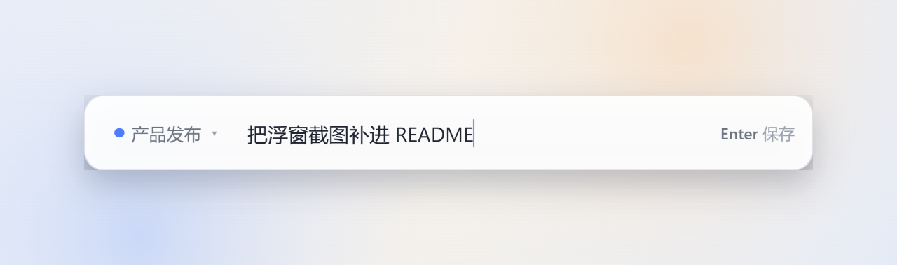

主窗口内另有一套固定键：`↑ ↓` 选中任务、`Space` 勾选、`Enter` 打开详情、
`Delete` 删除（5 秒内 `Ctrl+Z` 可撤销）、`Ctrl+N` 新建任务、`Ctrl+Shift+N` 新建笔记、
`Ctrl+Enter` 暂停 / 继续专注、`Ctrl+F` 搜索、`Ctrl+,` 打开设置。

全局键都能在 **设置 → 快捷键** 里录制修改：点右侧键位胶囊，按下新组合即可。
新键被别的程序占用时会当场说明并**保留原键**（不会出现「键换了、功能却没了」），
同一个组合也不会同时绑到两个动作上 —— 真要撞了，先注册的那个保留生效，另一个在列表里标出来，不再互相抢。
桌面浮窗的显隐键这次从 `Ctrl+Alt+H` 改成了 `Ctrl+Alt+D`：它和笔记键 `Ctrl+Shift+H` 只差一个修饰键，实机上太容易按混。
设置中心本身也重做了：左侧分组导航（外观 / 通用 / 快捷键 / AI 与语音 / 日历 / 工具 / 趣味功能 / 数据与备份 / 关于）+ 顶部搜索，改完立刻生效，没有「保存」按钮。侧栏底部的 ⚙ 与 `Ctrl+,` 都能打开它。

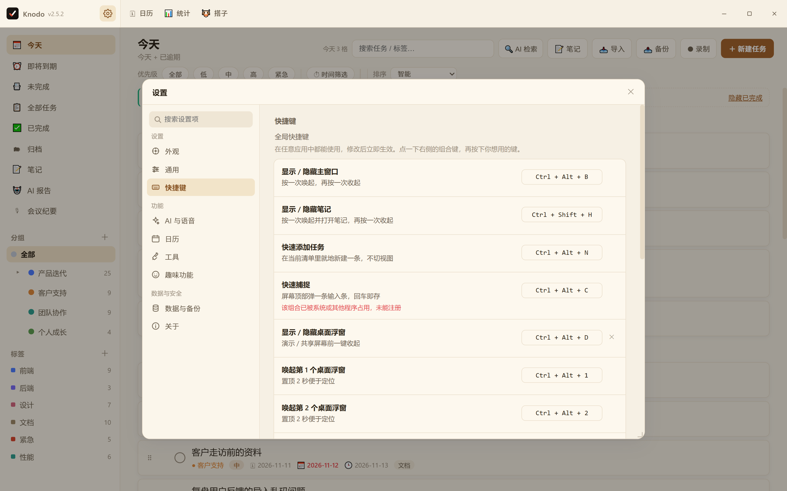

### 笔记导出

笔记视图工具栏的「📤 导出」可按目录 / 标签批量导出成自包含的 `.md`（图片内嵌），单篇笔记也能直接导出。

### 上班鼓励器 · 工位搭子

设置 → 趣味功能或 `Ctrl+Alt+E` 打开主浮窗：把工时拆成每秒进账、每天一支确定性签、
一只会按语气回话的几何小牛马、只换皮肤不换钱的牛马币，以及可导出的 1080×1440「今日牛马卡」。
浮窗放大到 640×720（随视口收敛），五个页签改成两栏 / 两列排布，一屏就能看全，不用上下滚。

**第一次打开先填薪资**：没填月薪时浮窗顶部会有一张引导卡，点「去填薪资 →」直接切到浮窗内的
「设置」页签；之后随时点右上角 ⚙ 也能回到这里。月薪 / 上班时间 / 下班时间三项边改边保存，
上方「今日已赚」立刻开始每秒跳动，不用点保存、也不用先去别处找设置。
完整路径是「设置 → 趣味功能 → 薪资与班次」，两处改的是同一份配置（`tool.salary`）。

**一份配置、一处计算**：数值统一由 `salary-core.js` 的 `computeSalary()` 算出，不在多处各算一笔钱。
「实时薪资（经典视图）」弹窗与 `Ctrl+Alt+L` 已撤掉，鼓励器是唯一的薪资进账界面。

**隐私默认**：分享卡默认不含真实金额、不含任务标题，想晒具体成果要主动勾选并二次确认。
所有数据只留在本机，没有账号、没有服务端、不联网生成文案。
主浮窗与分享卡都跟随应用明暗主题；鼓励器不再提供贴桌面小窗（侧栏清单 / 今天 / 即将到期的桌面浮窗不受影响）。

### 外观：六套配色，配自己的背景图

设置 → **外观**（分区第一项，不再藏在「通用」的一个下拉里）：

- **明暗**：跟随系统 / 浅色 / 深色。窗口标题栏与原生控件一起变，不是只把页面刷黑。
- **风格**：雾灰 / 石墨 / 苔绿 / 宣纸 / 樱粉 / 高对比。只换色相与质感，圆角、间距、字号一律不动 ——
  换个风格不该让肌肉记忆失效。卡片上是真实 token 渲染的缩略图，不是示意图。
- **背景图**：丢一张 JPG / PNG / WebP 进来，自动压到长边 2560（3000×1200 实测 804KB → 387KB）
  存进数据目录的 `attachments/theme/`。填充方式「铺满 / 完整 / 平铺」，模糊 0 / 8 / 16px，
  面板毛玻璃可关（关掉滚动更省 GPU）。
- **一个滑块就够**：它调的不是图片透明度，而是**面板表面的透明度** —— 图片越明显，面板自动越实。
  给图片层加 opacity 那种做法会被主题底色洗成灰雾、面板却仍然不透明，等于「什么都没变」。
- **护栏**：面板与卡片的合成色都按 WCAG 算对比度（sRGB 线性化后算，不是估个亮度），
  逼近 4.5:1 时自动把面板加深、最多 +12%，并在滑块下面写明「已加深 X%」；高对比风格锁在 30%，
  只能更实不能更透。
- 桌面浮窗只跟随「明暗 × 风格」、不铺背景图：巴掌大的窗口铺满照片只会看不清内容。

关闭窗口默认最小化到托盘；可设开机自启（安装版）、可把数据目录换到任意磁盘。

**升级怎么知道有新版本**：`File → 检查更新…`（或 设置 → 关于 → 检查更新）会去查本仓库的最新 Release；
启动约 8 秒后也会静默查一次，有新版只把菜单项标成「检查更新…（发现新版本）」并弹一条提示，
不弹窗打断你正在做的事。它只给下载链接、不自动安装 —— 便携版和安装版的替换方式本来就不一样。

---

## 快速开始

### 直接使用（不需要懂代码）

打开 **[最新版本](https://gitee.com/kiverson/todo-task/releases/latest)**（国内）/ **[GitHub Releases](https://github.com/kevin-iverson/knodo/releases/latest)**（海外），滑到页面最底部，按习惯挑一个：

| 文件 | 说明 |
|---|---|
| `Knodo-<版本>-便携版.7z` | **推荐**。解压一次后双击里面的 `Knodo.exe`（没有安装向导），数据在 exe 同级的 `data/`，整个文件夹拷走即可换机 |
| `Knodo-<版本>-安装版.exe` | 双击走安装向导，可选安装目录、生成桌面与开始菜单快捷方式；数据在 `%APPDATA%\todo-desktop`，可开开机自启 |

便携版是压缩包而不是单个 exe：单文件自解压版**每次启动都要把 337MiB 重新解到临时目录**
（实测 15 秒才出窗口），解压一次之后每次冷启动约 1.5 秒。用 7-Zip / WinRAR / Bandizip 解压
（Win11 24H2 起资源管理器可直接解）。

两个包功能完全一致，区别只在**装不装**和**数据放哪**：
固定一台电脑长期用选安装版（有快捷方式、能开机自启），换来换去或放 U 盘选便携版。

> ⚠️ 别点 `Source code (zip)` 或页面右上角绿色的「克隆/下载」——那是源代码，下下来用不了。

首次运行若被 Windows 拦下：点「更多信息 → 仍要运行」。
完整的图文步骤、被 360/电脑管家拦截的处理、数据在哪、怎么升级，
见 **[下载与安装](docs/下载与安装.md)**。

### 从源码运行

```bash
npm install     # 首次会下载 Electron 二进制
npm start
```

要求 **Node.js ≥ 18**、**Windows 10/11**。`better-sqlite3` 使用 N-API 预编译二进制，
不需要 Visual Studio 构建工具，也不需要 electron-rebuild。

> 在自带 `ELECTRON_RUN_AS_NODE=1` 的终端里启动会「一闪而过」，
> 用 `env -u ELECTRON_RUN_AS_NODE npm start`。详见[开发指南](docs/开发指南.md)。

---

## 技术栈

| 层 | 选型 |
|---|---|
| 运行环境 | Electron 44（主进程 + preload 收口，渲染层不碰文件系统与明文密钥） |
| 存储 | SQLite（`better-sqlite3`）+ FTS5 trigram 全文索引，WAL 模式 |
| 前端 | 原生 JS + CSS 变量主题，无框架；第三方库 vendor 进仓库、离线可用 |
| AI | OpenAI 兼容 `/chat/completions` 与 `/audio/transcriptions`，可换 DeepSeek / 通义 / Kimi / Ollama |
| 打包 | electron-builder（NSIS 安装版 + 便携版 7z），发布走 Gitee + GitHub 双发行版 |

---

## 文档

| 文档 | 你会在这里找到 |
|---|---|
| [下载与安装](docs/下载与安装.md) | 点哪个文件、被 Windows 拦截怎么办、数据在哪、升级与卸载 |
| [功能详解 · 任务与视图](docs/功能详解-任务与视图.md) | 分组、子任务、日期范围、筛选排序、详情抽屉、统计下钻、日历排期、重复待办与习惯 |
| [功能详解 · 笔记与知识库](docs/功能详解-笔记与知识库.md) | 所见即所得编辑器、Mermaid、图片、导入导出、检索、知识库问答 |
| [功能详解 · 会议纪要](docs/功能详解-会议纪要.md) | 录制、切片、转写、AI 纪要、待办入库 |
| [功能详解 · AI 能力](docs/功能详解-AI能力.md) | AI 设置、报告、检索联想逻辑、接口配置表 |
| [功能详解 · 效率工具与数据](docs/功能详解-效率工具.md) | 笔记导出、完整备份与自动快照、托盘与自启 |
| [常见问题](docs/常见问题.md) | 数据在哪、关闭没退出、无 Key 的表现、便携版限制 |
| [开发指南](docs/开发指南.md) | 目录结构、依赖策略、冒烟测试、调试 |
| [数据库设计](docs/数据库设计.md) | 表结构、迁移、FTS、附件协议、备份格式 |
| [打包与发布](docs/打包与发布.md) | 品牌标识、打包产物、7z 瘦身与 Gitee 发版 |

完整索引见 [docs/README.md](docs/README.md)。

---

## 许可

MIT License。第三方库的许可与来源版本登记在 `package.json` 中。
