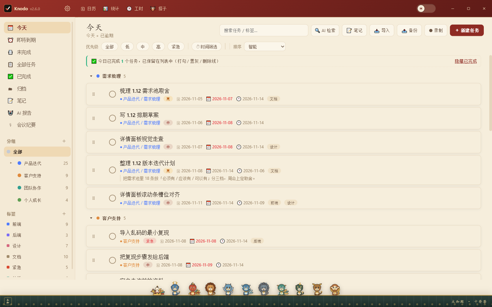
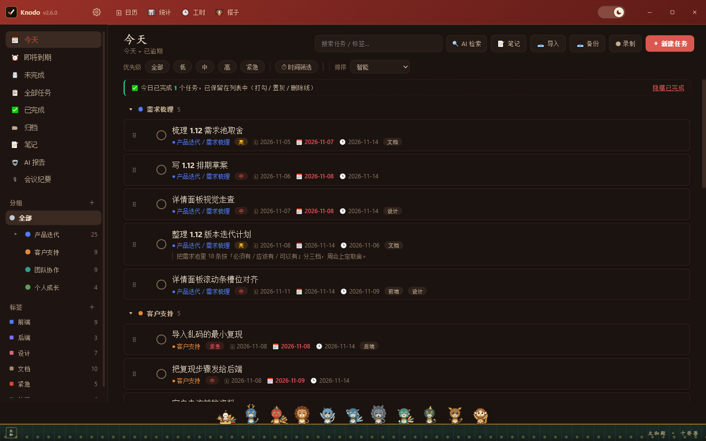
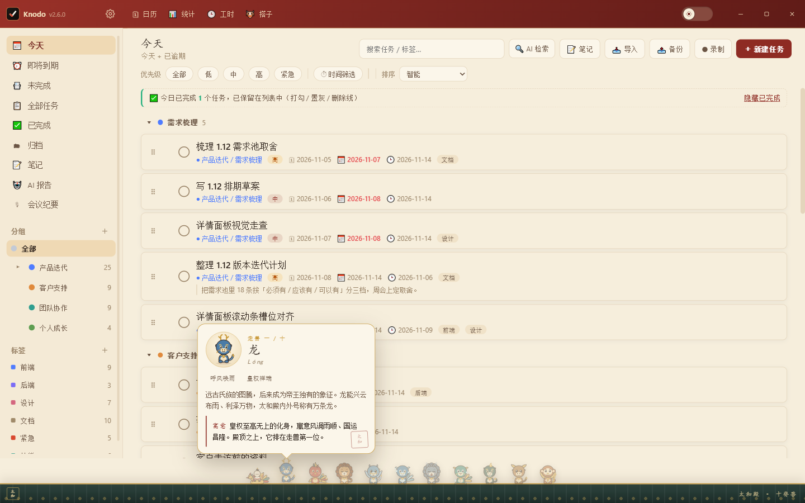

# 太和殿 · 脊兽 —— 故宫主题

把太和殿檐角的十只走兽与骑凤仙人（另有两尊石狮作为备选），做成一组卡通形象，陈设在界面边沿：依次排列，鼠标经过时介绍来历与寓意。本目录是形象源文件、主题设计稿，以及接进 Knodo 的落地说明。

## 打开

双击 `index.html` 即可（Chrome / Edge）。页面是纯静态的：普通 `<script>`，没有构建步骤，`file://` 直接可跑。

| 文件 | 作用 |
|---|---|
| `index.html` | 设计稿：檐角队列、角色设定集、明暗两套界面实景、色板 |
| `palace.css` | 设计稿样式（宣纸底 + 宫墙红 + 赤金） |
| `data.js` | 13 个形象与文案（名称 / 读音 / 位置 / 来历 / 寓意） |
| `page.js` | 队列与卡片渲染、悬停介绍卡、钉住、深链 |
| `svg/*.svg` | 13 个卡通形象源文件，透明底，128×128 画布 |

## 一队脊兽

次序按《大清会典》与故宫博物院公布：骑凤仙人领队，其后龙、凤、狮子、天马、海马、狻猊、押鱼、獬豸、斗牛、行什。太和殿是唯一用满十只走兽的建筑，多出来的是行什。

| 位次 | 形象 | 读音 | 一句话寓意 |
|---|---|---|---|
| 引 | 骑凤仙人 | Qí fèng xiān rén | 绝处逢生，逢凶化吉 |
| 一 | 龙 | Lóng | 皇权祥瑞，风调雨顺 |
| 二 | 凤 | Fèng | 百鸟之王，天下太平 |
| 三 | 狮子 | Shī zi | 勇猛威严，镇守辟邪 |
| 四 | 天马 | Tiān mǎ | 追风逐日，威德通天 |
| 五 | 海马 | Hǎi mǎ | 入海临渊，逢凶化吉 |
| 六 | 狻猊 | Suān ní | 龙子喜烟，护佑平安 |
| 七 | 押鱼 | Yā yú | 水族统领，灭火防灾 |
| 八 | 獬豸 | Xiè zhì | 独角辨曲直，司法象征 |
| 九 | 斗牛 | Dòu niú | 牛头龙身，祈雨灭灾 |
| 十 | 行什 | Xíng shí | 雷神化身，太和殿独有 |
| 门·东 | 石狮 · 雄 | Shí shī · xióng | 脚踏绣球，一统寰宇 |
| 门·西 | 石狮 · 雌 | Shí shī · cí | 抚育幼狮，子嗣绵延 |

> 说明：天马与海马、狻猊与押鱼的位置在部分文献中可互置，本稿采用故宫博物院公布的次序。
>
> 石狮是第一批设定里的备选形象。应用的檐口最终只保留十一尊檐角脊兽，石狮源文件仍留在 `svg/`，需要时可单独取用。

## 造型设定

- **世界观**：屋脊兽原本是钉住瓦片的铁钉帽，后来成了等级的语言。形象不画成威严的瑞兽，而做「宫里的猫」那种圆头、短身、爱坐的贴纸感。
- **骨架**：128×128 画布，落点 y≈118；头宽 58、身高 90，头大身小；所有形象共用同一副坐姿与项圈，辨识交给各自的角、冠、翼、尾、鳍。
- **线条**：2px 墨线（#3B2A20）+ 平涂，光源在左上，右下用同一色系的暗部压一层。
- **用色**：宫墙红、朱砂、琉璃黄、赤金、石青、石绿、汉白玉、宣纸、墨。每个形象一主色，金饰统一在项圈、铜铃、角冠上。
- **道具**：金项圈 + 铜铃是统一的「身份证」；各自的「身份物」是龙珠、绣球、幼狮、金刚杵、明镜、香炉烟、水珠。
- **石狮**：汉白玉色，刻痕用灰蓝；雄狮右爪踏绣球，雌狮左爪抚幼狮，项圈与铃铛和走兽同一套。

界面里 46–56px 能认出轮廓，120px 以上看细节。SVG 透明底，深浅背景都能直接放。

## 交互

- **悬停**：浮起介绍卡，含头像、位次、读音、来历、寓意；其余形象变淡，被指的那一尊抬起。
- **点击**：钉住卡片，方便读完；再点一次或点空白处、按 Esc 取消。
- **键盘**：Tab 聚焦每一尊，焦点态同样出卡。
- **边缘**：卡片固定定位并做边缘钳制，靠近窗口左右两端时自动收进来，箭头仍指向该形象。
- **深链**：`index.html?beast=tianma` 可直接钉住某一位（截图、分享、评审时用）。

## 放进界面

本目录的 `index.html` 是设计稿（「放回界面里」一节是浅色 / 深色的界面实景）。真正接进应用以后，落地方式是：

- 窗口底部一条 **80px** 的檐口：上 46px 站兽，下 34px 是深青绿琉璃瓦垄与瓦当，檐口顶部一道 2px 赤金脊线。
- 11 尊形象（骑凤仙人 + 十走兽）踩着脊线，间距 6px；窗口 ≤1080px 时缩小一档（40px / 72px）。
- 檐口在文档流里，内容不会被盖住；切到其他风格时整条收起，不占高度。
- 打开模态框 / 详情抽屉时檐口自动让位（`body:has(.modal-mask)`），不会在遮罩下面留一条亮边。
- 左印章「太和」、右小字「太和殿 · 十脊兽」。

**为什么放在底边**：应用顶部已有标题栏与工具栏，再放一排会与操作打架；底部檐口既是「台基」，也让脊兽有地方站。

## 在 Knodo 里使用

已经接进 `todo-app`：

- **切换**：设置 → 外观 → 风格 → **故宫 PALACE**（出厂默认）；切到其他风格檐口自动收起，不需要额外的开关。
- **交互**：悬停浮起来历与寓意；点击钉住；Esc / 点空白取消；Tab 可逐尊聚焦。
- **配色**：`renderer/js/theme-core.js` 里的 `palace`（`ORDER` 中宣纸之后，`base` 0.74）；主进程 `main/theme.js` 同步了 `STYLES` 与 `BG_HEX.palace`（启动底色，避免首帧闪白）。
- **素材**：`renderer/img/palace/*.svg`（13 个，透明底）。
- **檐口**：`renderer/css/palace-ridge.css` + `renderer/js/palace-rail.js`；`renderer/index.html` 里有一段 `.palace-rail` 容器，并引入了这两个文件。
- **设置页**：`renderer/js/settings.js` 的风格卡片由 `KT.ORDER` 自动生成；选中故宫时多一行说明。

验收口径：`node scripts/shots.js` 截图对比；深浅两态；窗口 1000 / 1440 各看一次；设置弹窗打开时确认檐口已让位；切换到宣纸确认檐口消失且布局回落。

## 素材与出处

- 次序、数量与建筑等级：故宫博物院「屋脊上的神秘小兽」、故宫青少版「屋脊上的神秘小兽」。
- 齐湣王与凤凰的传说、行什为雷震子化身等：同上与常见民间说法，文案中已作「传说」处理。
- 形象、文案与界面为原创绘制与整理；可随项目使用。

## 改动记录

- 造型：统一骨架与金铃项圈；龙、凤、天马、海马、狻猊、押鱼、獬豸、斗牛、行什、两尊石狮逐一绘制。
- 设计稿：檐角队列 + 悬停介绍 + 钉住；界面实景（明暗两套）；色板与形制说明。
- 应用：新增「故宫 PALACE」风格、底部脊兽檐口、悬停介绍卡与设置页说明；模态打开时檐口让位。
