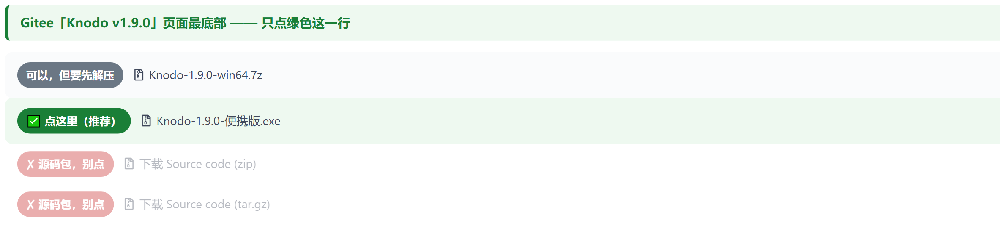

# 下载与安装

> 这份文档写给「只想把软件用起来」的人：**不用懂 Git，不用装 Node.js，不用看仓库里任何代码**。
> 全程三步，加起来不到两分钟。

如果你是程序员、想看源码怎么跑，直接跳到 [开发指南](开发指南.md)。

---

## 一句话版（可以直接转发给朋友）

复制下面这段发给对方就行：

```text
装这个：https://gitee.com/kiverson/todo-task/releases/latest
打开后滑到页面最底部，点「Knodo-x.x.x-便携版.7z」（想装进系统就点「安装版.exe」），
解压到任意文件夹（只需解压这一次），双击里面的 Knodo.exe 就能用。
如果弹出「Windows 已保护你的电脑」，点「更多信息」→「仍要运行」。
```

---

## 第一步：打开下载页

唯一需要记住的地址：

**<https://gitee.com/kiverson/todo-task/releases/latest>**

它会自动跳到最新版本。**页面很长，有用的东西在最底部**——一路往下滑，
看到一排文件名就对了。



## 第二步：挑一个 exe

两个包**功能完全一样**，区别只在「装不装」和「数据放哪」：

| 文件名 | 它是什么 | 数据在哪 | 适合谁 |
|---|---|---|---|
| `Knodo-x.y.z-便携版.7z` | 压缩包绿色版，**解压一次**后双击即用，没有安装向导 | exe 旁边的 `data` 文件夹 | ✅ **大多数人**；换电脑频繁、放 U 盘 |
| `Knodo-x.y.z-安装版.exe` | 走安装向导，可选安装目录、生成桌面与开始菜单快捷方式 | `%APPDATA%\todo-desktop` | 固定一台电脑长期用，想要快捷方式和开机自启 |

其余几行都**不要点**：

| 你看到的名字 | 它到底是什么 | 该不该点 |
|---|---|---|
| `Source code (zip)` / `Source code (tar.gz)` | 源代码 | ❌ 下下来是一堆代码文件，双击没用 |
| 页面右上角绿色的「克隆/下载」按钮 | 源代码 | ❌ 同上 |

> 判断标准很简单：**文件大的那两个**（`安装版.exe` 和 `便携版.7z`）才是能用的程序（各约 92MB）。
> 便携版需要先用 7-Zip / WinRAR / Bandizip 解压一次（Win11 24H2 起资源管理器可直接解）；
> 带 `Source code` 的都是给开发者看的源码。

## 第三步：双击运行

**便携版**：先把 `.7z` 解压到任意文件夹（右键 → 7-Zip / WinRAR / Bandizip「解压到当前文件夹」；
Win11 24H2 起资源管理器也能直接解）。**只需解压这一次**，之后双击文件夹里的 `Knodo.exe`，
约 1.5 秒出主界面。

不要每次都双击那个 `.7z`——那样每次都要重新解压，反而要等十几秒。

**安装版**：双击后出现安装向导，可以改安装位置（默认装到当前用户，**不需要管理员权限**），
装完自动创建快捷方式，勾选「运行 Knodo」即可。

第一次运行时 Windows 很可能拦你一下，见下一节。

---

## 被拦住了怎么办

这是个人开源项目最常见的三道坎，都是「没买代码签名证书」导致的，不是病毒。
证书一年要几千块，个人项目一般不买，所以 Windows 与国产安全软件都会提示「未知发布者」。

### 1. Windows 蓝色弹窗「Windows 已保护你的电脑」

点弹窗里的 **「更多信息」**，下面会多出一行 **「仍要运行」**，点它。

### 2. 360 / 电脑管家 / 火绒 弹窗「发现未知文件」

选 **「允许运行」/「信任此文件」/「添加到白名单」**。如果已经被拦下并删掉了，
去「隔离区」恢复，再加信任。

### 3. 公司电脑禁止运行未知程序

这种情况两个包都过不去——需要 IT 部门给这个 exe 加白名单。个人电脑不会遇到。

---

## 装好之后，三件需要知道的事

**① 不用注册、不用登录、不联网也能用。**
第一次打开就是完整的任务 + 笔记功能，没有账号、没有激活码、没有试用期。
AI 相关功能需要你自己填一个 API Key，不填也能用，只是少了总结与语义检索。

**② 数据在哪。**

- **便携版**：会在 exe 同一个文件夹里自动建一个 `data` 文件夹，里面是整个数据库和你的附件。
  - 想换电脑：**把整个文件夹（exe + data）拷到 U 盘，拷到新电脑就能继续用**；
  - 想备份：复制 `data` 文件夹，或者用应用内的「导出」做一个完整 zip；
  - **千万别单独删 `data`**，那是你所有的任务和笔记。
- **安装版**：数据在 `%APPDATA%\todo-desktop`（设置 → 数据与备份 里能看到实际路径，
  也可以改到别的磁盘）。卸载时向导会问要不要一并删除数据。

**③ 开机自启两边都支持。**
安装版与解压后的便携版都能在设置里开启，登录后静默驻留托盘、不弹窗。
便携版是「跟着文件夹走」的：把文件夹挪了位置，需要回来重新开一次自启。
（旧的单文件自解压便携版因为每次解压到临时目录、路径不固定，才不提供这个开关。）

---

## 以后怎么升级

**便携版**：下载新版 `Knodo-新版本-便携版.7z`，**解压到旧的同一个文件夹、覆盖同名文件**。
数据认的是同级的 `data` 文件夹，而压缩包里不含 `data`，所以覆盖不会丢数据。
确认能正常打开后，旧的临时文件可以不管。

**安装版**：直接下载新版 `Knodo-新版本-安装版.exe` 再装一次即可，会覆盖旧版本，数据在原处不动。

两种方式都建议**升级前先在应用里导出一次备份**，这是唯一的保险。
想知道有没有新版：打开 设置 → 关于 → 检查更新。

## 怎么卸载

- **便携版**：先在设置里关掉开机自启，然后把整个文件夹删掉即可；
  如果想留着数据，只删程序文件、保留 `data` 文件夹。没有卸载残留、没有后台服务。
- **安装版**：设置 → 应用 → 已安装的应用 → Knodo → 卸载（或从开始菜单的卸载快捷方式进），
  向导会问是否保留用户数据。

---

## 便携版和安装版，到底选哪个

| | 便携版 `.7z` | 安装版 `.exe` |
|---|---|---|
| 安装方式 | 解压一次后双击即用，无向导 | 走安装向导（可改路径） |
| 需要管理员权限 | 不需要 | 不需要（默认装当前用户） |
| 数据存放位置 | exe 同级的 `data` 文件夹 | `%APPDATA%\todo-desktop` |
| 换电脑 | 整个文件夹拷走即可 | 要单独备份数据 |
| U 盘随身带 | 适合 | 不适合 |
| 桌面 / 开始菜单快捷方式 | 没有（自己建也行） | 自动创建 |
| 开机自启 | 支持（挪动文件夹后需重开） | 支持 |
| 卸载 | 删文件夹 | 走系统卸载 |

---

## 还是打不开？

| 现象 | 可能原因 | 怎么办 |
|---|---|---|
| 双击没反应 | 下成了 `Source code` 源码包，或下到一半没下完 | 回下载页确认文件名与大小（约 92MB），重下 |
| 弹窗一闪就没了 | 被安全软件静默拦截 | 查安全软件的拦截记录 / 隔离区，加白名单后重试 |
| 提示「无法运行此应用」 | 系统太旧（Win7 / Win8） | Knodo 需要 Windows 10（1809 及以上）或 Windows 11，64 位 |
| 打开后界面空白 | 显卡/渲染异常 | 关掉应用重开；仍不行请反馈系统版本 |
| 想确认下载是否完整 | — | 对照下载页上显示的文件大小，一致即可 |

更多使用层面的疑问（数据在哪、关闭窗口为什么还在托盘、备份怎么用）
见 [常见问题](常见问题.md)。
