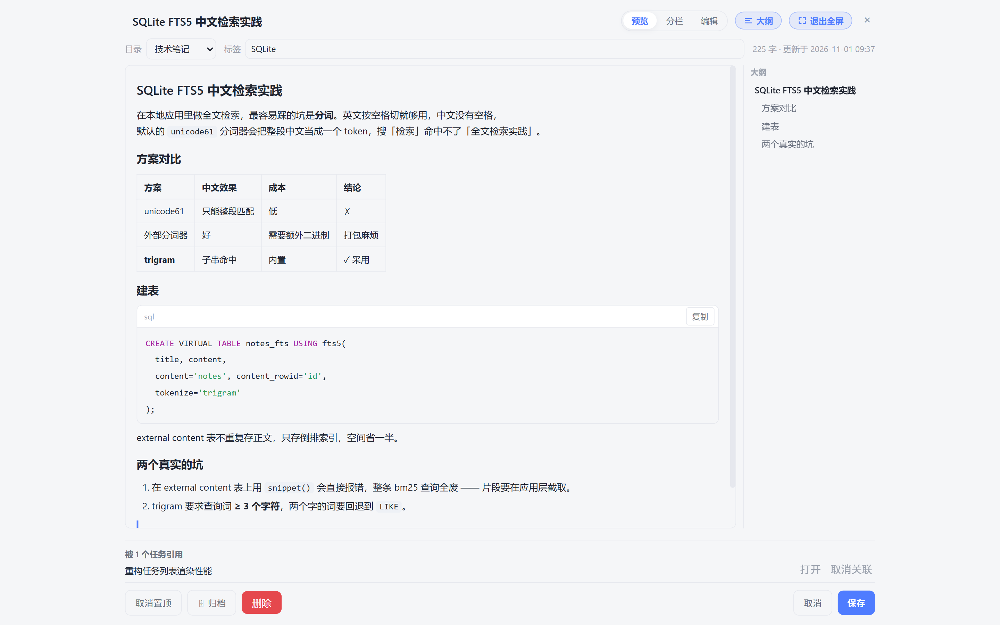
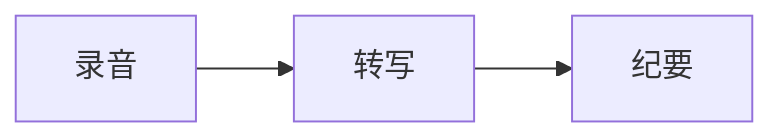

# 功能详解 · 笔记与知识库

笔记是 Knodo 里「Knowledge」的一半：写下来的东西不是躺在文件夹里的死文本，而是能被全文检索、
被任务引用、被 AI 检索问答的知识库。本文覆盖编辑、组织、检索、导入导出与知识库问答。

> 相关文档：[任务与视图](功能详解-任务与视图.md) · [AI 能力](功能详解-AI能力.md) · [笔记模块设计与AI知识库接入](笔记模块设计与AI知识库接入.md)

---

## 一、界面

笔记视图是标准三栏：**目录 / 标签（左）→ 笔记列表（中）→ 详情面板（右）**。

- 左侧：目录树（无限层级）+ 标签云，顶部有搜索框。
- 中间：笔记卡片列表，显示标题、摘要、时间、字数、标签与「被 N 个任务引用」标记。
- 右侧：选中笔记的详情面板 —— 默认**只读展示**，点右上角「✎ 编辑」才进入可编辑态；
  右上角另有「大纲」「全屏」。
- 顶部工具栏：＋ 新建笔记 / 搜索 / 归档夹 / 回收站 / 🧠 知识库问答 / 📥 导入 / 📤 导出 / 计数。

**「📝 笔记」弹窗**：任务视图顶栏搜索框内右侧的 📝 按钮会在当前页面上弹出同一套笔记界面
（1320 × 900 上限），关掉回到原处，列表的筛选与滚动位置不会丢。做任务时想查一句话，
不用离开当前视图。

---

## 二、所见即所得编辑器

打开笔记默认进入**只读展示态**：工具条隐藏，正文与标题 / 目录 / 标签都不可输入、删除或粘贴，
连附件删除按钮也禁用；正文里不会显示 `**`、`#`、`==`、``` 之类的 Markdown 标记。
点右上角「✎ 编辑」才进入可编辑态，工具条出现；点「✓ 完成」或按 Esc 退出，自动隐藏工具条、
立即保存并恢复只读。两态共用**同一份渲染 DOM 与同一套样式**，切态不重渲，排版完全一致、
内容与格式零丢失。

- 工具条吸顶：正文再长，工具条也固定在标题 / 目录行下方不动，滚到任何位置都能直接排版。
- 工具条：段落样式（正文 / 标题 1–3 / 引用）、加粗 / 斜体 / 下划线 / 删除线、字体颜色与背景高亮、
  三级标题、有序 / 无序列表、引用、代码块（先选语言）、表格、分割线、链接、图片、撤销 / 重做、快捷键速查。
- 快捷键：`Ctrl+B / I / U`、`Ctrl+Shift+X`（删除线）、`Ctrl+Alt+0~3`（正文 / 三级标题）、
  `Ctrl+Shift+7 / 8`（有序 / 无序列表）、`Ctrl+K`（链接）、`Ctrl+Alt+C`（代码块，弹语言列表）、
  `Ctrl+Z / Ctrl+Shift+Z`（撤销 / 重做）、
  `Ctrl+S`（立即保存）、`Ctrl+F`（查找）、`Esc`（退出编辑）。
- 数据仍以 Markdown 存在 `notes.content_md`：读入按顶层块渲染并记住原文片段，
  保存时未改动的块原样复用、只把改过的块交给 turndown 回写。颜色高亮、Mermaid、代码块语言、
  表格、`todo-media:///` 图片这些自定义语法都有专门的还原规则，老笔记不会被规范化掉。
- 标题、目录、标签、正文改完约 **0.9s 自动落库**（状态条：未保存 / 保存中 / 已保存 HH:MM），
  退出编辑 / 关闭面板前也会补存一次。
- **全屏**：把整个详情面板铺满窗口，适合长文写作；Esc 退出。
- **查找**（Ctrl+F）：在渲染结果里高亮命中。源码态已移除，替换请直接选中文字改写。
- **文字颜色与高亮**：选中文字后点工具条「A」「H」即可，颜色随笔记保存，
  导出与检索都会先剥掉标记再计算字数。



---

## 三、代码块与图表

### 代码块

````markdown
```sql
SELECT * FROM tasks WHERE completed = 0;
```
````

- 按语言着色（highlight.js，内置 30+ 语言，不认识的自动识别），带语言标签与一键复制。
- **选语言**：工具条点「</>」先弹语言面板（纯文本 / JS / TS / Python / Java / Go / Rust / C / C++ /
  C# / PHP / HTML / CSS / SCSS / JSON / YAML / XML / SQL / Shell / Dockerfile / Diff /
  Markdown / Mermaid / INI，三列网格，选中即插入并带语言标签）；
  已插入的代码块在编辑态点左上角语言标签即可随时改语言，代码内容原样保留。
  选「Mermaid 图表」写的块，退出编辑后渲染成图。
- 编辑态下代码块是纯文本（高亮 span 会被输入打断、留下空壳），退出编辑时按最新 Markdown 重渲一次，
  高亮与语言标签回到与「重新打开笔记」完全一致的渲染态。
- 代码块里的 Tab 缩进按 **2 空格**显示；代码块整体可编辑，改动会连同语言标签一起回写。

### Mermaid 图表

````markdown

````

- 支持 **流程图 / 时序图 / 类图 / 甘特图 / 饼图** 五类，渲染为矢量 SVG。
- 其余图表类型会在加载渲染库之前就被拦下：保留源码 + 提示不支持，不会白屏。
- 双击图表可全屏放大（可拖动、可缩放，Esc 关闭），长图不会把正文撑变形。
- 鼠标移到图上，右上角露出 **⤢ 放大** 与 **⬇ 下载**：下载走系统「另存为」导出 2 倍分辨率 PNG，
  按图块自身的背景色铺底，深色主题导出的图直接贴进白底文档也不会糊成一片。
- 语法错误时就地显示源码，方便直接改。

> mermaid 库按需懒加载，构建期只打进来这五类图表（含布局引擎 elkjs），
> 未用到的图表模块被替换为空桩，体积从 5.0MB 降到 3.6MB。

---

## 四、图片与附件

- 截图**直接粘贴**、拖拽文件、工具栏选文件三种方式都能插入图片。
- 文件落盘到 `<数据目录>/attachments/note-<笔记id>/<附件id>_<文件名>`（与任务附件同一套规则），
  正文只留 `todo-media:///note-<id>/<附件id>_<文件名>` 链接，**不塞 base64**（正文不会被撑成几 MB）。
- 编辑器下方有图片条：可打开原图 / 复制引用 / 删除。
- 渲染时由主进程注册的 `todo-media://` 协议映射回本地文件，只解析附件目录内的路径，越界拒绝。

---

## 五、组织：目录、标签、置顶、归档

- **目录**：无限层级，同级不允许重名（与分组同一套规则）；可设颜色。
- **标签**：逗号分隔输入，不存在的自动创建；笔记标签与任务标签**互相独立**，避免污染筛选。
- **置顶**：常用笔记钉在列表顶部。
- **归档**：归档后折叠出主列表，但仍可被检索与引用。

---

## 六、搜索与回收站

- **全文检索**走 SQLite FTS5（`trigram` 分词，中文无需外部分词器即可命中子串）；
  关键词不足 3 个字符时自动回退模糊匹配（`LIKE`）。
- 删除分两级：**移入回收站（可恢复）** 与 **彻底删除**。回收站页可逐篇恢复 / 彻底删除 / 清空。
  软删除会保留任务引用，恢复后关联自动复原。

---

## 七、导入 Markdown

工具栏「📥 导入」（或菜单栏 File → 导入 Markdown 笔记…）支持：

- 选择**单个 / 多个 `.md` 文件**，或**整个文件夹递归扫描**。
- 标题取自首个一级标题（没有则用文件名）；front matter 里的 `title` / `tags` 会被识别。
- 正文里相对路径的本地图片会一并搬进附件目录，并改写成 `todo-media:///` 引用。

---

## 八、导出笔记

入口只有笔记视图工具栏「📤 导出」（打开的单篇笔记右栏「⬇ 导出」可跳过筛选直接导这一篇），两种形态：

| 形态 | 适用场景 |
|---|---|
| 每篇一个 `.md` 的压缩包 | 按目录层级批量备份 / 迁移到别的笔记工具 |
| 单文件合集 | 整篇粘贴到其他编辑器或归档留存 |

> 导出是单向的：只生成文件，不改动本地数据。

---

## 九、知识库沉淀与问答

笔记保存即自动切块入索引（按 Markdown 标题切分，块内带标题路径），无需手动「上传」。

「🧠 知识库问答」的检索链路：

```
AI 查询改写 → 多路召回（分块 FTS + 笔记级 + 模糊）→ RRF 融合 → AI 语义重排 → 带 [n] 出处作答
```

- 回答里的 `[n]` 可点击跳回原笔记。
- **未配置 AI Key 时整条链路自动降级为纯关键词召回**，功能不中断，只是没有语义重排与生成。
- 问答历史单独存 `kb_qa` 表（随备份走）。

---

## 十、任务 ↔ 笔记（多对多）

- 任务详情可一次关联多篇笔记（搜索 + 多选 + 顺手新建），列表项支持跳转查看与取消关联。
- 任务列表行显示 `📝 N` 徽标，一眼看出这条任务攒了几篇资料。
- 笔记详情底部显示「被 N 个任务引用」，可打开任务或取消关联。

---

## 十一、实现要点（给维护者）

- 模块：`renderer/js/notes.js`（视图与保存）、`wysiwyg.js`（所见即所得两态 / 工具条 / 快捷键 /
  DOM→Markdown 序列化）、`note-find.js`（渲染结果查找）、`note-picker.js`（任务侧选择器）、
  `markdown-lib.js`（markdown-it 封装 + 代码高亮 + Mermaid + 按块渲染）、`mermaid-zoom.js`（图表放大）；
  主进程侧 `main/md-import.js`（导入）、`knowledge.js`（切块与检索）。
- 序列化依赖 `turndown` + `turndown-plugin-gfm`（devDependencies，UMD 产物随仓库放在
  `renderer/vendor/turndown/`，离线可运行）；升级时同步替换 vendor 文件。
- 工具条类名是 `.nt-wys-bar` —— 顶部笔记列表工具栏已占用 `.nt-toolbar` 且是 `flex-wrap:wrap`，
  **不要复用类名**，否则编辑工具条会被挤成两行。
- 笔记详情面板有两种宿主（右栏 `#view` / 弹窗 `#nt-dock`），共用同一套 `detailHtml / mountEditor / bindSaver`；
  `editor` / `saver` 是模块级单例，换宿主前必须 dispose。
- 派生数据（`word_count` / `content_hash` / `notes_fts` / `kb_chunks`）计算前必须先剥掉内联样式标记。
- 表结构与迁移见 [数据库设计](数据库设计.md)；检索链路的设计取舍见
  [笔记模块设计与AI知识库接入](笔记模块设计与AI知识库接入.md)。
